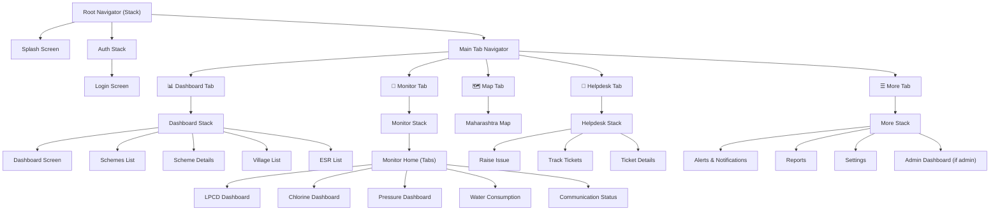
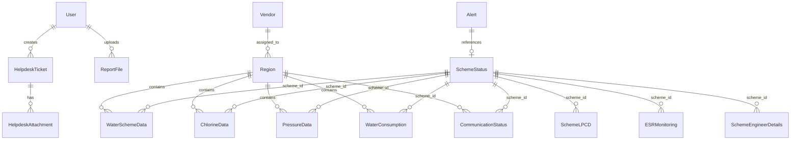
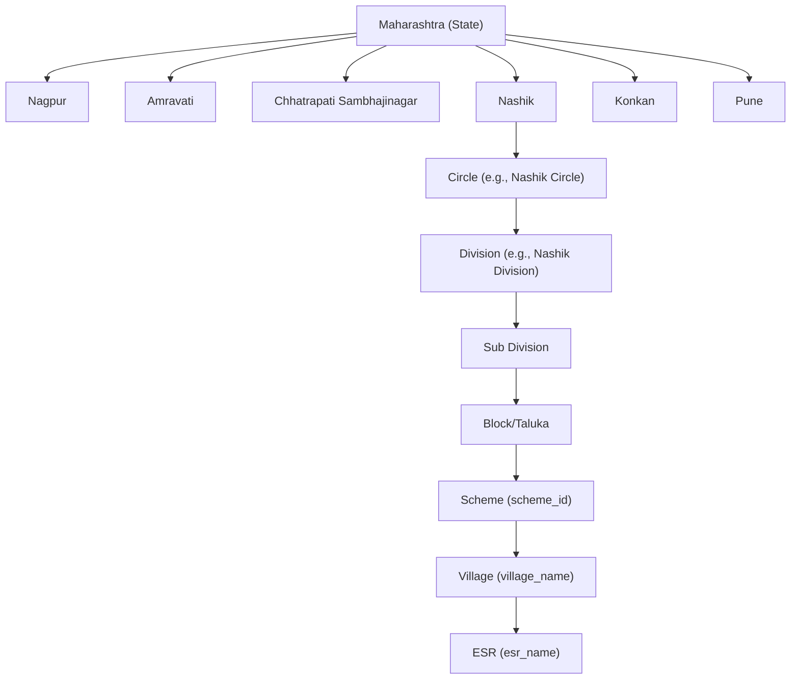

# MOBILE APPLICATION IMPLEMENTATION PLAN
## Maharashtra Water Infrastructure Management Platform — MahaJal IoT
### React Native Mobile Application Blueprint

> **Document Version**: 1.0
> **Created**: 2026-06-18
> **Source**: `MASTER_KNOWLEDGE_BASE.md` (dashboard9 / Rishi2532/dashboard9)
> **Production Web URL**: `https://dashboard1.mahajaliot.in`
> **Target**: React Native (iOS + Android)

---

> [!IMPORTANT]
> This document is the **definitive blueprint** for building the React Native mobile application.
> Another AI agent should be able to build the complete application using this document alone,
> without revisiting the original web repository.

---

# TABLE OF CONTENTS

1. [Phase 1 — Product Analysis](#phase-1--product-analysis)
2. [Phase 2 — Feature Inventory](#phase-2--feature-inventory)
3. [Phase 3 — User Roles & Permissions](#phase-3--user-roles--permissions)
4. [Phase 4 — Screen Planning](#phase-4--screen-planning)
5. [Phase 5 — Navigation Architecture](#phase-5--navigation-architecture)
6. [Phase 6 — Data Architecture](#phase-6--data-architecture)
7. [Phase 7 — Mock Data Strategy](#phase-7--mock-data-strategy)
8. [Phase 8 — API Abstraction Strategy](#phase-8--api-abstraction-strategy)
9. [Phase 9 — Offline-First Strategy](#phase-9--offline-first-strategy)
10. [Phase 10 — Scalability Strategy](#phase-10--scalability-strategy)
11. [Phase 11 — Recommended Tech Stack](#phase-11--recommended-tech-stack)
12. [Phase 12 — Development Roadmap](#phase-12--development-roadmap)

---

# PHASE 1 — PRODUCT ANALYSIS

## 1.1 Platform Summary

The web platform is the **Maharashtra State Water Infrastructure Management Platform** built for **Jal Jeevan Mission (JJM)** / **SWSM (State Water and Sanitation Mission)**. It monitors IoT-enabled water supply infrastructure across Maharashtra's 6 regions, tracking:

- **LPCD** (Liters Per Capita Per Day) per village
- **Chlorine levels** at ESR (Elevated Service Reservoir) points
- **Pressure** at ESR points
- **Water consumption** at ESR points
- **Sensor communication status** (online/offline)
- **Scheme progress** and commissioning status

The platform serves state government officials, regional engineers, and field staff with dashboards, maps, reports, alerts, and a helpdesk system.

## 1.2 Mobile Suitability Analysis

### Features to Include in Mobile (Direct Port)

| Web Feature | Mobile Relevance | Business Value | Complexity | Priority |
|---|---|---|---|---|
| **Main Dashboard** | ★★★★★ — Field engineers need at-a-glance stats on the go | Critical — primary daily tool | High | **P0** |
| **Scheme Listing & Details** | ★★★★★ — Lookup scheme status in the field | Critical — core workflow | Medium | **P0** |
| **LPCD Monitoring** | ★★★★★ — Core water supply KPI | Critical — regulatory metric | Medium | **P0** |
| **Chlorine Monitoring** | ★★★★★ — Water safety compliance | Critical — public health | Medium | **P0** |
| **Pressure Monitoring** | ★★★★★ — Infrastructure health | High — operational metric | Medium | **P1** |
| **Water Consumption** | ★★★★★ — Usage patterns | High — operational metric | Medium | **P1** |
| **Communication Status** | ★★★★★ — Sensor health, field troubleshooting | Critical — field maintenance | Medium | **P0** |
| **Helpdesk (Raise Issue)** | ★★★★★ — Report issues from the field | Critical — field workflow | Medium | **P1** |
| **Helpdesk (Track Tickets)** | ★★★★★ — Follow up on issues | High — user productivity | Low | **P1** |
| **Alerts & Progress** | ★★★★★ — Push notifications on critical alerts | Critical — response time | Medium | **P1** |
| **Reports (Download)** | ★★★★☆ — Download/share PDF/Excel | High — compliance/reporting | Medium | **P2** |
| **Multi-language Support** | ★★★★★ — Field staff in rural areas need Marathi/Hindi | Critical — accessibility | Low | **P1** |
| **Authentication** | ★★★★★ — Secure access | Critical — security baseline | Low | **P0** |
| **Settings** | ★★★★☆ — Language, theme, profile | Medium — user preference | Low | **P2** |

### Features to Modify for Mobile

| Web Feature | Modification Needed | Rationale |
|---|---|---|
| **Maharashtra Map (GIS)** | Replace Leaflet/SVG with `react-native-maps` + simplified GeoJSON | Web map libraries don't work natively; use native map SDKs |
| **Dashboard Charts** | Replace Recharts with `react-native-chart-kit` or `victory-native` | Recharts is DOM-based; need native SVG charting |
| **Data Tables** | Replace HTML tables with `FlatList` + card-based layouts | Horizontal scrolling tables are poor UX on mobile; use cards + expandable rows |
| **PDF Generation** | Use `react-native-print` or server-side PDF generation | `pdfmake` is browser-based; need native printing APIs |
| **Excel Import/Export** | Simplify to download-only or server-side processing | File picking + parsing on mobile is limited |
| **Geographic Filter Dropdowns** | Convert to bottom-sheet cascading pickers | Nested dropdown menus are unusable on mobile |
| **Chatbot** | Omit voice recognition initially; use text-only chatbot | Web Speech API unavailable natively; add voice later via `expo-speech` |

### Features to Omit from Mobile

| Web Feature | Reason for Omission |
|---|---|
| **MQTT Monitor** (real-time topic viewer) | DevOps tool — not needed for field users |
| **MQTT Topic Configuration** | Admin configuration — desktop only |
| **Admin Data Import** (CSV/Excel upload) | Complex file operations better suited to desktop; admin-only |
| **Admin Chlorine Import** | Same as above |
| **Admin Communication Import** | Same as above |
| **Admin Manage Reports** (file management) | Desktop admin workflow |
| **Admin Login Logs** | Audit tool — desktop admin panel |
| **Monthly Reports** (generation) | Complex report generation — trigger from desktop, view on mobile |
| **User Registration** | Controlled by admins; users don't self-register in government systems |
| **Forgot Password** | Low priority; handle via admin or web portal |
| **Map Preview / Interactive Map Demo** | Demo/preview pages; not production features |

### Features Requiring Mobile-First Redesign

| Feature | Redesign Approach |
|---|---|
| **Dashboard** | Card-based scrollable layout with collapsible sections instead of dense grid |
| **Scheme Details** (68KB page) | Tabbed interface — Overview / LPCD / Chlorine / Pressure / History |
| **Water Consumption** (136KB page) | Progressive disclosure — summary cards → drill-down detail |
| **Chlorine Dashboard** (141KB page) | Split into Summary + Detailed tabs |
| **Geographic Hierarchy Browser** | Tree view with collapsible nodes, search-first design |
| **Region Comparison** | Swipeable cards per region instead of side-by-side table |

---

# PHASE 2 — FEATURE INVENTORY

## 2.1 Feature Matrix

### Core Features

| # | Feature Name | Purpose | Dependencies | Mobile Equivalent | Complexity | Priority |
|---|---|---|---|---|---|---|
| 1 | **Main Dashboard** | Central overview with stats, charts, regional metrics | Auth, Scheme data, Regional data, LPCD data, Charts | Scrollable card-based dashboard with summary stats, mini-charts, region selector | High | **P0** |
| 2 | **Scheme Listing** | Browse/search/filter all water schemes | Auth, Scheme data, Geographic filters | Searchable FlatList with filter chips, pull-to-refresh | Medium | **P0** |
| 3 | **Scheme Details** | View individual scheme: status, LPCD, chlorine, pressure, villages, ESRs | Auth, Scheme data, History data | Tabbed screen: Overview / Water / Quality / Sensors | High | **P0** |
| 4 | **LPCD Monitoring** | Track Liters Per Capita Per Day by village with 7-day rolling window | Auth, LPCD data, Classification logic | List view with color-coded status badges (>55, <55, zero) | Medium | **P0** |
| 5 | **Chlorine Monitoring** | Track chlorine levels at ESR points | Auth, Chlorine data, Classification logic | Summary cards + searchable list with status badges (optimal/below/above) | Medium | **P0** |
| 6 | **Pressure Monitoring** | Track pressure levels at ESR points | Auth, Pressure data, Classification logic | Summary cards + searchable list with status badges | Medium | **P1** |
| 7 | **Water Consumption** | Track water consumption at ESR level | Auth, Water consumption data | Summary + list view with daily trends | Medium | **P1** |
| 8 | **Communication Status** | Monitor sensor online/offline status | Auth, Communication data, MQTT status | List with status indicators, filter by communicating/not-communicating | Medium | **P0** |

### Reporting Features

| # | Feature Name | Purpose | Dependencies | Mobile Equivalent | Complexity | Priority |
|---|---|---|---|---|---|---|
| 9 | **Report Download** | Download pre-generated PDF/Excel reports | Auth, Report files API | List of available reports with download/share action | Low | **P2** |
| 10 | **Smart Reports** | AI-generated analytical reports | Auth, OpenAI API (mock initially) | Request report → display generated text summary | Medium | **P3** |

### GIS Features

| # | Feature Name | Purpose | Dependencies | Mobile Equivalent | Complexity | Priority |
|---|---|---|---|---|---|---|
| 11 | **Maharashtra Map** | Interactive state map with region drill-down, scheme markers | Auth, GeoJSON data, Map SDK | Native map with region polygons, scheme pins, bottom sheet details | High | **P2** |

### Helpdesk Features

| # | Feature Name | Purpose | Dependencies | Mobile Equivalent | Complexity | Priority |
|---|---|---|---|---|---|---|
| 12 | **Raise Issue** | Create helpdesk ticket from the field | Auth, Helpdesk API, Camera (attachments) | Form with category picker, description, photo capture | Medium | **P1** |
| 13 | **Track Tickets** | View and track user's tickets | Auth, Helpdesk API | List view with status badges, pull-to-refresh | Low | **P1** |
| 14 | **Ticket Details** | View individual ticket with history | Auth, Helpdesk API | Detail view with status timeline, attachments | Low | **P1** |
| 15 | **Issue Reporting** | Justification/remark for failed parameters | Auth, Issue Reporting API | Form screen with parameter selection + remarks | Medium | **P2** |

### Authentication Features

| # | Feature Name | Purpose | Dependencies | Mobile Equivalent | Complexity | Priority |
|---|---|---|---|---|---|---|
| 16 | **Login** | User authentication | Auth API (mock initially) | Login screen with username/password + biometric option | Low | **P0** |
| 17 | **Session Management** | Maintain authenticated state | Secure storage, Token management | AsyncStorage/SecureStore for token persistence | Low | **P0** |
| 18 | **Logout** | End session | Auth API | Profile menu → Logout action | Low | **P0** |

### Monitoring Features

| # | Feature Name | Purpose | Dependencies | Mobile Equivalent | Complexity | Priority |
|---|---|---|---|---|---|---|
| 19 | **Alerts & Notifications** | Critical parameter alerts with acknowledgement | Alerts API, Push notifications | Push notification + in-app alerts list with acknowledge action | Medium | **P1** |
| 20 | **Population Tracking** | Population metrics with trends | Population API | Card with animated counter + sparkline chart | Low | **P2** |

### Dashboard Features

| # | Feature Name | Purpose | Dependencies | Mobile Equivalent | Complexity | Priority |
|---|---|---|---|---|---|---|
| 21 | **Regional Comparison** | Compare metrics across 6 regions | Regional stats API | Horizontal bar chart or swipeable region cards | Medium | **P2** |
| 22 | **Stat Cards** | Summary KPI cards (total schemes, villages, ESRs, etc.) | Dashboard API | Animated stat cards in a 2-column grid | Low | **P0** |

### Utility Features

| # | Feature Name | Purpose | Dependencies | Mobile Equivalent | Complexity | Priority |
|---|---|---|---|---|---|---|
| 23 | **Multi-language** | Support for Hindi, Marathi, English (+ 7 more Indian languages) | Translation service (mock initially) | Language picker in settings; translated text throughout | Low | **P1** |
| 24 | **Theme Support** | Light/dark mode | Theme context | System theme detection + manual toggle | Low | **P2** |
| 25 | **Village List** | Browse all villages | Village data API | Searchable FlatList with geographic filters | Low | **P2** |
| 26 | **ESR List** | Browse all ESRs | ESR data API | Searchable FlatList with status indicators | Low | **P2** |

### Administrative Features (Mobile-Limited)

| # | Feature Name | Purpose | Dependencies | Mobile Equivalent | Complexity | Priority |
|---|---|---|---|---|---|---|
| 27 | **Admin Dashboard** | System overview for admins | Admin API, Admin role | Simplified admin summary cards (view-only) | Low | **P3** |
| 28 | **Admin Helpdesk** | Manage all helpdesk tickets | Admin role, Helpdesk API | Admin ticket list with status update actions | Medium | **P3** |

---

# PHASE 3 — USER ROLES & PERMISSIONS

## 3.1 Discovered Roles

Based on the knowledge base analysis, the platform has a **two-tier role system** (user vs admin) with **geographic filtering** providing implicit hierarchical access:

| Role | Source | Description |
|---|---|---|
| **Admin** | `session.isAdmin = true` | Full system access: all dashboards + import + manage + logs |
| **User** | `session.isAdmin = false` | View all dashboards, create helpdesk tickets, download reports |

> [!NOTE]
> The web platform uses a simple `isAdmin` boolean. The geographic hierarchy (Region → Circle → Division → Sub Division → Block → Scheme) acts as a **data filter**, not a permission boundary. All authenticated users can view all regions, but the UI defaults to their assigned region context.

## 3.2 Mobile Role Definitions

For the mobile app, we define roles with explicit permission scoping. This is forward-looking — the current web system has only 2 roles, but the mobile architecture should support future expansion.

### Admin Role

| Permission | Screens Accessible | Restrictions |
|---|---|---|
| View all dashboards | Dashboard, Schemes, LPCD, Chlorine, Pressure, Water Consumption, Communication, Map, Reports, Alerts | None |
| Manage helpdesk | Admin Helpdesk screen | Can update any ticket status |
| View admin dashboard | Admin Dashboard | View-only summary on mobile |
| View login logs | N/A (omitted from mobile) | — |
| Import data | N/A (omitted from mobile) | — |
| Manage reports | N/A (omitted from mobile) | — |

### User Role

| Permission | Screens Accessible | Restrictions |
|---|---|---|
| View dashboards | Dashboard, Schemes, LPCD, Chlorine, Pressure, Water Consumption, Communication, Map | Read-only |
| Raise helpdesk issues | Raise Issue, Track Tickets, Ticket Details | Can only view own tickets |
| Download reports | Reports | Download only, no manage |
| View alerts | Alerts & Progress | Acknowledge own alerts |
| Change settings | Settings | Language, theme only |

## 3.3 Role-Permission Matrix

```
Permission                    │ Admin │ User │
──────────────────────────────┼───────┼──────┤
View Dashboard                │  ✅   │  ✅  │
View Scheme List              │  ✅   │  ✅  │
View Scheme Details           │  ✅   │  ✅  │
View LPCD Data                │  ✅   │  ✅  │
View Chlorine Data            │  ✅   │  ✅  │
View Pressure Data            │  ✅   │  ✅  │
View Water Consumption        │  ✅   │  ✅  │
View Communication Status     │  ✅   │  ✅  │
View Maharashtra Map          │  ✅   │  ✅  │
Download Reports              │  ✅   │  ✅  │
View Alerts                   │  ✅   │  ✅  │
Acknowledge Alerts            │  ✅   │  ✅  │
Create Helpdesk Ticket        │  ✅   │  ✅  │
View Own Tickets              │  ✅   │  ✅  │
View All Tickets              │  ✅   │  ❌  │
Update Ticket Status          │  ✅   │  ❌  │
View Admin Dashboard          │  ✅   │  ❌  │
Change Language/Theme         │  ✅   │  ✅  │
Request Smart Report          │  ✅   │  ✅  │
```

## 3.4 Future Role Expansion

The architecture should support adding these roles without major refactoring:

| Future Role | Scope | Use Case |
|---|---|---|
| **State User** | All regions | State-level officials viewing aggregate data |
| **Regional User** | Single region (e.g., Nashik) | Regional officers filtered to their jurisdiction |
| **Division User** | Single division within a region | Division-level engineers |
| **Field User** | Single block or scheme | Field technicians at specific schemes |
| **Contractor** | Assigned schemes only | Third-party maintenance contractors |
| **Agency User (MJP/ZP)** | Schemes under their agency | Agency-specific views |

### Implementation Strategy for Future Roles

```typescript
// Role definition (future-ready)
interface UserRole {
  id: string;
  name: string;
  level: 'state' | 'region' | 'division' | 'block' | 'scheme';
  permissions: Permission[];
  geoScope: {
    region?: string;
    circle?: string;
    division?: string;
    subDivision?: string;
    block?: string;
    schemeIds?: string[];
  };
}
```

---

# PHASE 4 — SCREEN PLANNING

## 4.1 Complete Screen Inventory

### Authentication Screens

#### AUTH-01: Login Screen
- **Purpose**: User authentication entry point
- **User Roles**: All (pre-auth)
- **Data Requirements**: None (form submission)
- **APIs Required**: `POST /api/auth/login` (mock initially)
- **Offline Requirements**: Show "No connection" message; allow cached login with stored token
- **Mobile Layout**: Centered card with logo, username field, password field, login button, biometric option
- **Component Breakdown**:
  - `Logo` — JJM / MahaJal IoT logo
  - `UsernameInput` — Text input with user icon
  - `PasswordInput` — Secure text input with eye toggle
  - `LoginButton` — Primary CTA
  - `BiometricButton` — Fingerprint/FaceID (future)
  - `LanguageSelector` — Bottom language toggle (EN / HI / MR)
- **Data Dependencies**: Auth service mock
- **Future Backend**: Replace mock auth with `POST /api/auth/login` session endpoint

---

#### AUTH-02: Splash Screen
- **Purpose**: App loading, auto-login check
- **User Roles**: All
- **Data Requirements**: Stored auth token
- **APIs Required**: `GET /api/auth/status` (mock initially)
- **Offline Requirements**: Check stored credentials; proceed to dashboard if valid token
- **Mobile Layout**: Full screen with animated JJM logo → auto-navigate
- **Component Breakdown**:
  - `AnimatedLogo` — Fade-in + scale animation
  - `LoadingIndicator` — Activity indicator below logo
- **Data Dependencies**: SecureStore token check
- **Future Backend**: Token validation via `GET /api/auth/status`

---

### Main Screens

#### MAIN-01: Dashboard Screen
- **Purpose**: Central overview — the most important screen
- **User Roles**: Admin, User
- **Data Requirements**:
  - Total schemes, villages, ESRs count
  - Regional statistics (6 regions)
  - LPCD summary (above 55 / below 55 / zero)
  - Chlorine summary (optimal / below / above)
  - Pressure summary (low / optimal / high)
  - Communication summary (online / offline count)
  - Population data
- **APIs Required**:
  - `GET /api/water-scheme-data` (summary stats)
  - `GET /api/water-scheme-data/regional-stats`
  - `GET /api/chlorine/regional-stats`
  - `GET /api/pressure/regional-stats`
  - `GET /api/communication-status` (summary)
  - `GET /api/population-tracking`
- **Offline Requirements**: Cache last dashboard data; show stale indicator with timestamp
- **Mobile Layout**: Vertical scroll with sections
- **Component Breakdown**:
  - `RegionSelector` — Horizontal chip scrollbar (All / Nagpur / Amravati / etc.)
  - `StatCardGrid` — 2×3 grid of animated KPI cards:
    - Total Schemes (with icon)
    - Total Villages
    - Total ESRs
    - Population
    - Communicating Sensors (%)
    - LPCD Avg
  - `LPCDSummaryCard` — Donut chart showing above/below/zero breakdown
  - `ChlorineSummaryCard` — Donut chart showing optimal/below/above
  - `PressureSummaryCard` — Donut chart showing low/optimal/high
  - `RegionComparisonChart` — Horizontal bar chart by region
  - `CommunicationStatusCard` — Online vs offline sensor count with percentage ring
  - `QuickActionsBar` — Shortcut buttons: Schemes / Alerts / Helpdesk / Reports
- **Data Dependencies**: Mock: `dashboardSummary.json`, `regionalStats.json`
- **Future Backend**: Direct API integration

---

#### MAIN-02: Schemes List Screen
- **Purpose**: Browse, search, and filter all water schemes
- **User Roles**: Admin, User
- **Data Requirements**: List of schemes with: scheme_id, scheme_name, region, circle, division, block, village_count, esr_count, agency (MJP/ZP), commissioned status, functional status
- **APIs Required**: `GET /api/water-scheme-data` with filters
- **Offline Requirements**: Cache full scheme list; allow offline search
- **Mobile Layout**: Search bar + filter chips + FlatList
- **Component Breakdown**:
  - `SearchBar` — Text search by scheme name or ID
  - `FilterChips` — Region, Agency (MJP/ZP), Status
  - `FilterBottomSheet` — Full filter panel (Region → Division → Block cascade)
  - `SchemeListItem` — Card with: scheme name, ID, region, village count, status badge
  - `PullToRefresh` — Pull-down refresh
  - `EmptyState` — No results illustration
- **Data Dependencies**: Mock: `schemes.json`
- **Future Backend**: `GET /api/water-scheme-data` with query params

---

#### MAIN-03: Scheme Details Screen
- **Purpose**: Deep dive into a single water scheme
- **User Roles**: Admin, User
- **Data Requirements**:
  - Scheme metadata (name, ID, region, division, block, agency, status)
  - Village list for this scheme with LPCD data (7-day rolling)
  - ESR list for this scheme with chlorine/pressure data
  - Historical trends
  - Communication status per sensor
  - Engineer contact details
- **APIs Required**:
  - `GET /api/water-scheme-data/scheme-stats?schemeId=X`
  - `GET /api/water-scheme-data/village-stats?schemeId=X`
  - `GET /api/chlorine?schemeId=X`
  - `GET /api/pressure?schemeId=X`
  - `GET /api/water-consumption?schemeId=X`
  - `GET /api/communication-status?schemeId=X`
  - `GET /api/water-scheme-data/history/:schemeId`
- **Offline Requirements**: Cache scheme details when viewed; available offline
- **Mobile Layout**: Header card + Tab navigator
- **Component Breakdown**:
  - `SchemeHeaderCard` — Name, ID, status badges, agency, commissioned date
  - `TabNavigator` — Tabs: Overview | Villages | ESRs | History
  - **Overview Tab**:
    - `StatRow` — Village count, ESR count, population, avg LPCD
    - `LPCDBreakdownChart` — Pie: above/below/zero villages
    - `EngineerContactCard` — Name, phone, email with call/email actions
  - **Villages Tab**:
    - `VillageListItem` — Village name, population, LPCD value, 7-day trend sparkline, status badge
  - **ESRs Tab**:
    - `ESRListItem` — ESR name, village, chlorine value, pressure value, communication status indicator
  - **History Tab**:
    - `HistoryChart` — Line chart of LPCD / chlorine / pressure over time
    - `DateRangePicker` — 7 / 14 / 30 day selector
- **Data Dependencies**: Mock: `schemeDetails.json`, `villagesByScheme.json`, `esrsByScheme.json`
- **Future Backend**: Direct API queries with schemeId filter

---

#### MAIN-04: LPCD Dashboard Screen
- **Purpose**: Village-level LPCD tracking across all schemes
- **User Roles**: Admin, User
- **Data Requirements**:
  - Village-level LPCD data with 7-day rolling values
  - Classification: above 55 / below 55 / zero
  - Regional breakdown
- **APIs Required**: `GET /api/water-scheme-data` with geographic filters, `GET /api/scheme-lpcd-data`
- **Offline Requirements**: Cache last snapshot; show offline indicator
- **Mobile Layout**: Summary cards + filter + list
- **Component Breakdown**:
  - `LPCDSummaryCards` — 3 cards: Above 55 count (green), Below 55 count (amber), Zero count (red)
  - `RegionSelector` — Filter by region
  - `VillageLPCDList` — FlatList with: village name, scheme, LPCD value, status color
  - `SortSelector` — Sort by LPCD value (asc/desc), alphabetical
- **Data Dependencies**: Mock: `lpcdData.json`
- **Future Backend**: `GET /api/water-scheme-data` + `GET /api/scheme-lpcd-data`

---

#### MAIN-05: Chlorine Dashboard Screen
- **Purpose**: ESR-level chlorine monitoring
- **User Roles**: Admin, User
- **Data Requirements**:
  - Chlorine readings per ESR with 7-day rolling values
  - Classification: Optimal (0.2-0.5), Below 0.2, Above 0.5
  - Regional breakdown
- **APIs Required**: `GET /api/chlorine`, `GET /api/chlorine/regional-stats`
- **Offline Requirements**: Cache last snapshot
- **Mobile Layout**: Summary cards + searchable list
- **Component Breakdown**:
  - `ChlorineSummaryCards` — 3 cards: Optimal (green), Below (red), Above (amber)
  - `RegionSelector`
  - `ChlorineESRList` — FlatList: ESR name, village, scheme, latest value, status badge
  - `ChlorineDetailSheet` — Bottom sheet on tap: 7-day values, trend sparkline
- **Data Dependencies**: Mock: `chlorineData.json`
- **Future Backend**: `GET /api/chlorine` with filters

---

#### MAIN-06: Pressure Dashboard Screen
- **Purpose**: ESR-level pressure monitoring
- **User Roles**: Admin, User
- **Data Requirements**: Pressure readings per ESR, classification: Low (<0.2), Optimal (0.2-0.7), High (>0.7)
- **APIs Required**: `GET /api/pressure`, `GET /api/pressure/regional-stats`
- **Offline Requirements**: Cache last snapshot
- **Mobile Layout**: Same pattern as Chlorine Dashboard
- **Component Breakdown**: Mirror Chlorine Dashboard with pressure-specific labels/thresholds
- **Data Dependencies**: Mock: `pressureData.json`
- **Future Backend**: `GET /api/pressure` with filters

---

#### MAIN-07: Water Consumption Screen
- **Purpose**: ESR-level water consumption analysis
- **User Roles**: Admin, User
- **Data Requirements**: Water consumption readings per ESR, daily trends
- **APIs Required**: `GET /api/water-consumption`
- **Offline Requirements**: Cache last snapshot
- **Mobile Layout**: Summary + list pattern
- **Component Breakdown**: Similar to Chlorine/Pressure with consumption-specific metrics
- **Data Dependencies**: Mock: `waterConsumption.json`
- **Future Backend**: `GET /api/water-consumption`

---

#### MAIN-08: Communication Status Screen
- **Purpose**: Monitor sensor connectivity status — critical for field troubleshooting
- **User Roles**: Admin, User
- **Data Requirements**:
  - Per-sensor communication status (communicating / not communicating)
  - Time-since-last-message classification (0-72h, >72h)
  - Sensor type (Flow Meter, Chlorine 4-20mA, Chlorine Rs485, Pressure)
  - Vendor contact info for non-communicating sensors
- **APIs Required**: `GET /api/communication-status`, `GET /api/vendors`
- **Offline Requirements**: Cache full status list; critical for offline field use
- **Mobile Layout**: Status summary + filterable list
- **Component Breakdown**:
  - `CommStatusSummary` — Ring chart: communicating vs not communicating
  - `FilterToggle` — Show All / Not Communicating Only
  - `SensorStatusList` — FlatList: scheme, village, ESR, sensor type, status badge, last seen time
  - `VendorContactSheet` — Bottom sheet with vendor phone/email on long press
- **Data Dependencies**: Mock: `communicationStatus.json`, `vendors.json`
- **Future Backend**: `GET /api/communication-status`

---

#### MAIN-09: Alerts & Notifications Screen
- **Purpose**: View and acknowledge critical parameter alerts
- **User Roles**: Admin, User
- **Data Requirements**: Alert list with type, severity, scheme/village, timestamp, acknowledge status
- **APIs Required**: `GET /api/alerts-progress`, `GET /api/acknowledge?token=xxx`
- **Offline Requirements**: Cache alert list; queue acknowledgements for sync
- **Mobile Layout**: Notification-style list with swipe actions
- **Component Breakdown**:
  - `AlertFilterTabs` — All / Critical / Warning / Acknowledged
  - `AlertListItem` — Type icon, description, timestamp, scheme name, swipe to acknowledge
  - `AlertDetailSheet` — Bottom sheet with full details + acknowledge button
- **Data Dependencies**: Mock: `alerts.json`
- **Future Backend**: `GET /api/alerts-progress`

---

#### MAIN-10: Reports Screen
- **Purpose**: Download available reports
- **User Roles**: Admin, User
- **Data Requirements**: List of available report files with name, type, date, size
- **APIs Required**: `GET /api/reports` (list), `GET /api/reports/:id/download` (file)
- **Offline Requirements**: Cache report list; downloaded reports available offline
- **Mobile Layout**: Simple list with download/share actions
- **Component Breakdown**:
  - `ReportListItem` — Report name, date, type badge (PDF/Excel), download button
  - `DownloadProgress` — Inline progress indicator
  - `ShareAction` — Native share sheet after download
- **Data Dependencies**: Mock: `reports.json`
- **Future Backend**: `GET /api/reports`

---

#### MAIN-11: Maharashtra Map Screen
- **Purpose**: Geographic visualization with region drill-down
- **User Roles**: Admin, User
- **Data Requirements**: GeoJSON region/district boundaries, scheme coordinates, regional stats
- **APIs Required**: `GET /api/water-scheme-data/regional-stats`
- **Offline Requirements**: Embed GeoJSON data; map tiles may be unavailable offline
- **Mobile Layout**: Full-screen native map with overlays
- **Component Breakdown**:
  - `NativeMap` — `react-native-maps` MapView with region polygons
  - `RegionPolygonOverlay` — 6 region boundaries with color fill based on metrics
  - `SchemeMarker` — Pins for schemes (clustered at high zoom-out)
  - `RegionDetailSheet` — Bottom sheet on region tap: stats, scheme count, metrics
  - `MetricToggle` — Toggle map coloring by: LPCD / Chlorine / Pressure / Communication
- **Data Dependencies**: Embedded: `maharashtra-regions.json`, `maharashtra-districts.geojson`; Mock: `regionalStats.json`
- **Future Backend**: Direct API + real-time updates

---

### Helpdesk Screens

#### HELP-01: Raise Issue Screen
- **Purpose**: Create a new helpdesk ticket from the field
- **User Roles**: Admin, User
- **Data Requirements**: Scheme list (for selection), category list, user info
- **APIs Required**: `POST /api/helpdesk/tickets` (mock initially)
- **Offline Requirements**: Queue ticket for upload when online; save draft locally
- **Mobile Layout**: Multi-step form or scrollable form
- **Component Breakdown**:
  - `CategoryPicker` — Dropdown/bottom sheet for issue category
  - `SchemePicker` — Searchable scheme selector
  - `DescriptionInput` — Multi-line text area
  - `PrioritySelector` — Low / Medium / High / Critical
  - `PhotoCapture` — Camera button for attaching photos
  - `AttachmentPreview` — Thumbnail grid of attached photos
  - `SubmitButton` — With loading state
  - `OfflineQueueBadge` — "Will be submitted when online" indicator
- **Data Dependencies**: Mock: `categories.json`, `schemes.json` (for picker)
- **Future Backend**: `POST /api/helpdesk/tickets` with multipart form data

---

#### HELP-02: Track Tickets Screen
- **Purpose**: View user's helpdesk tickets
- **User Roles**: Admin (all tickets), User (own tickets only)
- **APIs Required**: `GET /api/helpdesk/tickets`
- **Offline Requirements**: Cache ticket list
- **Mobile Layout**: Filterable list
- **Component Breakdown**:
  - `StatusFilterTabs` — All / Open / In Progress / Resolved / Closed
  - `TicketListItem` — Ticket ID, title, status badge, date, scheme name
  - `PullToRefresh`
- **Data Dependencies**: Mock: `tickets.json`
- **Future Backend**: `GET /api/helpdesk/tickets`

---

#### HELP-03: Ticket Details Screen
- **Purpose**: View individual ticket details and history
- **User Roles**: Admin, User (own tickets)
- **APIs Required**: `GET /api/helpdesk/tickets/:id`, `GET /api/helpdesk/tickets/:id/attachments`
- **Offline Requirements**: Cache viewed ticket details
- **Mobile Layout**: Scrollable detail view
- **Component Breakdown**:
  - `TicketHeader` — ID, title, status badge, priority badge
  - `TicketMetadata` — Created date, scheme, category, reporter
  - `DescriptionCard` — Full description text
  - `AttachmentGallery` — Photo grid with full-screen viewer
  - `StatusTimeline` — Vertical timeline of status changes
  - `AdminActions` (admin only) — Update status dropdown, add comment
- **Data Dependencies**: Mock: `ticketDetails.json`
- **Future Backend**: `GET /api/helpdesk/tickets/:id`

---

### Settings Screens

#### SET-01: Settings Screen
- **Purpose**: User preferences and app configuration
- **User Roles**: All
- **Data Requirements**: Current user profile, language preference, theme preference
- **APIs Required**: `GET /api/auth/status` (user info)
- **Offline Requirements**: Fully offline (all settings are local)
- **Mobile Layout**: Grouped settings list
- **Component Breakdown**:
  - `ProfileSection` — Avatar, name, role badge
  - `LanguageSelector` — List of 10 languages (English, Hindi, Marathi, etc.)
  - `ThemeSelector` — Light / Dark / System
  - `NotificationSettings` — Push notification toggle
  - `CacheManagement` — Clear cache, show cache size
  - `AboutSection` — App version, build number
  - `LogoutButton` — Destructive action with confirmation
- **Data Dependencies**: Local preferences
- **Future Backend**: User profile API

---

## 4.2 Screen Count Summary

| Category | Screen Count |
|---|---|
| Authentication | 2 (Login, Splash) |
| Main Dashboards | 8 (Dashboard, Schemes, Scheme Details, LPCD, Chlorine, Pressure, Water Consumption, Communication) |
| Map | 1 (Maharashtra Map) |
| Alerts | 1 (Alerts & Notifications) |
| Reports | 1 (Reports) |
| Helpdesk | 3 (Raise Issue, Track Tickets, Ticket Details) |
| Settings | 1 (Settings) |
| **Total** | **17 screens** |

---

# PHASE 5 — NAVIGATION ARCHITECTURE

## 5.1 Navigation Structure



## 5.2 Navigation Implementation

### Root Navigator (Stack)

```
RootStack
├── SplashScreen          (initialRoute, no header)
├── AuthStack             (no header, no back)
│   └── LoginScreen
└── MainTabs              (no header, tab bar visible)
```

### Main Tab Navigator (Bottom Tabs)

| Tab | Icon | Label | Stack |
|---|---|---|---|
| Dashboard | `LayoutDashboard` | Dashboard | DashboardStack |
| Monitor | `Activity` | Monitor | MonitorStack |
| Map | `Map` | Map | MapScreen (no stack) |
| Helpdesk | `TicketCheck` | Helpdesk | HelpdeskStack |
| More | `Menu` | More | MoreStack |

### Dashboard Stack

```
DashboardStack
├── DashboardScreen       (tab bar visible)
├── SchemesListScreen     (tab bar hidden)
├── SchemeDetailsScreen   (tab bar hidden)
├── VillageListScreen     (tab bar hidden)
└── ESRListScreen         (tab bar hidden)
```

### Monitor Stack

```
MonitorStack
├── MonitorHomeScreen     (tab bar visible, with top tabs)
│   ├── LPCDTab
│   ├── ChlorineTab
│   ├── PressureTab
│   ├── WaterConsumptionTab
│   └── CommunicationTab
```

### Helpdesk Stack

```
HelpdeskStack
├── TrackTicketsScreen    (tab bar visible)
├── RaiseIssueScreen      (tab bar hidden, modal presentation)
└── TicketDetailsScreen   (tab bar hidden)
```

### More Stack

```
MoreStack
├── MoreMenuScreen        (tab bar visible)
├── AlertsScreen          (tab bar hidden)
├── ReportsScreen         (tab bar hidden)
├── SettingsScreen        (tab bar hidden)
└── AdminDashboardScreen  (tab bar hidden, admin only)
```

## 5.3 Deep Linking Schema

```
mahajal://                              → Splash / Dashboard
mahajal://login                         → Login
mahajal://dashboard                     → Dashboard
mahajal://schemes                       → Scheme List
mahajal://schemes/:schemeId             → Scheme Details
mahajal://schemes/:schemeId/:block      → Scheme Details (block-specific)
mahajal://monitor/lpcd                  → LPCD Dashboard
mahajal://monitor/chlorine              → Chlorine Dashboard
mahajal://monitor/pressure              → Pressure Dashboard
mahajal://monitor/water-consumption     → Water Consumption
mahajal://monitor/communication         → Communication Status
mahajal://map                           → Maharashtra Map
mahajal://helpdesk                      → Track Tickets
mahajal://helpdesk/raise                → Raise Issue
mahajal://helpdesk/ticket/:id           → Ticket Details
mahajal://alerts                        → Alerts
mahajal://reports                       → Reports
mahajal://settings                      → Settings
```

## 5.4 User Journeys

### Journey 1: Field Engineer Morning Check

```
Open App → Splash → Dashboard
  → View stat cards (schemes, LPCD, communication)
  → Tap "Not Communicating" card
  → Communication Status Screen (filtered to offline)
  → Tap a sensor → Bottom sheet with vendor contact
  → Tap phone number → Call vendor
```

### Journey 2: LPCD Compliance Check

```
Dashboard → Tap "LPCD Below 55" card
  → LPCD Dashboard (filtered to below 55)
  → Tap a village → Scheme Details → Villages Tab
  → View 7-day LPCD trend
  → Tap "Report Issue" → Raise Issue form (pre-filled scheme)
```

### Journey 3: Chlorine Alarm Response

```
Push Notification: "Chlorine below threshold at Scheme X"
  → Tap notification → Scheme Details → ESRs Tab
  → View chlorine reading → Tap ESR
  → Bottom sheet: 7-day chlorine trend, last reading
  → Acknowledge alert
```

### Journey 4: Helpdesk Ticket Lifecycle

```
Helpdesk Tab → Raise Issue
  → Select scheme → Select category → Add description
  → Take photo → Submit
  → Track Tickets → View submitted ticket
  → (Later) Pull to refresh → See status update
```

---

# PHASE 6 — DATA ARCHITECTURE

## 6.1 Entity Catalog

All entities below are derived directly from the web platform's `shared/schema.ts` (Drizzle ORM schema) and database tables.

### Entity: User

| Field | Type | Description | Source Table |
|---|---|---|---|
| `id` | integer (PK, auto) | User ID | `users` |
| `username` | string | Login username | `users` |
| `password` | string | Password (⚠️ stored plain text in web) | `users` |
| `name` | string | Display name | `users` |
| `email` | string (nullable) | User email | `users` |
| `phone` | string (nullable) | Phone number | `users` |
| `role` | string | `"admin"` or `"user"` | `users` |
| `isAdmin` | boolean | Admin flag | `users` |
| `region` | string (nullable) | Assigned region | `users` |
| `createdAt` | timestamp | Account creation | `users` |

### Entity: Region

| Field | Type | Description | Source Table |
|---|---|---|---|
| `regionId` | integer (PK, auto) | Region ID | `region` |
| `regionName` | string | Region name | `region` |
| `totalSchemes` | integer | Number of schemes | `region` |
| `totalVillages` | integer | Number of villages | `region` |
| `totalEsr` | integer | Number of ESRs | `region` |
| `totalPopulation` | integer | Total population served | `region` |
| `above55Count` | integer | Villages with LPCD > 55 | `region` |
| `below55Count` | integer | Villages with LPCD < 55 | `region` |
| `zeroCount` | integer | Villages with zero water supply | `region` |

**Known Regions** (6 total):
1. Nagpur
2. Amravati
3. Chhatrapati Sambhajinagar
4. Nashik
5. Konkan
6. Pune

### Entity: WaterSchemeData (Village-Level LPCD)

| Field | Type | Description | Source Table |
|---|---|---|---|
| `schemeId` | string (PK) | Scheme identifier | `water_scheme_data` |
| `schemeName` | string | Scheme name | `water_scheme_data` |
| `villageName` | string (PK) | Village name | `water_scheme_data` |
| `block` | string (PK) | Block/taluka name | `water_scheme_data` |
| `region` | string | Region | `water_scheme_data` |
| `circle` | string | Circle | `water_scheme_data` |
| `division` | string | Division | `water_scheme_data` |
| `subDivision` | string | Sub-division | `water_scheme_data` |
| `population` | integer | Village population | `water_scheme_data` |
| `valueDayN` (×7) | numeric | LPCD value for day N | `water_scheme_data` |
| `dateDayN` (×7) | string | Date for day N | `water_scheme_data` |
| `lpcdAvg` | numeric | 7-day LPCD average | Computed |
| `status` | string | above_55 / below_55 / zero | Computed |

### Entity: SchemeLPCD (Scheme-Level LPCD)

| Field | Type | Description | Source Table |
|---|---|---|---|
| `schemeId` | string (PK) | Scheme identifier | `scheme_lpcd` |
| `block` | string (PK) | Block name | `scheme_lpcd` |
| `schemeName` | string | Scheme name | `scheme_lpcd` |
| `region` | string | Region | `scheme_lpcd` |
| `circle` | string | Circle | `scheme_lpcd` |
| `division` | string | Division | `scheme_lpcd` |
| `valueDayN` (×7) | numeric | Scheme LPCD day N | `scheme_lpcd` |
| `dateDayN` (×7) | string | Date for day N | `scheme_lpcd` |

### Entity: ChlorineData

| Field | Type | Description | Source Table |
|---|---|---|---|
| `schemeId` | string (PK) | Scheme identifier | `chlorine_data` |
| `villageName` | string (PK) | Village name | `chlorine_data` |
| `esrName` | string (PK) | ESR name | `chlorine_data` |
| `schemeName` | string | Scheme name | `chlorine_data` |
| `region` | string | Region | `chlorine_data` |
| `circle` | string | Circle | `chlorine_data` |
| `division` | string | Division | `chlorine_data` |
| `subDivision` | string | Sub-division | `chlorine_data` |
| `block` | string | Block | `chlorine_data` |
| `sensorType` | string | Sensor type (4-20mA, Rs485) | `chlorine_data` |
| `valueDayN` (×7) | numeric | Chlorine mg/L day N | `chlorine_data` |
| `dateDayN` (×7) | string | Date for day N | `chlorine_data` |

### Entity: PressureData

| Field | Type | Description | Source Table |
|---|---|---|---|
| `schemeId` | string (PK) | Scheme identifier | `pressure_data` |
| `villageName` | string (PK) | Village name | `pressure_data` |
| `esrName` | string (PK) | ESR name | `pressure_data` |
| `schemeName` | string | Scheme name | `pressure_data` |
| `region` | string | Region | `pressure_data` |
| `circle`–`block` | string | Geographic hierarchy | `pressure_data` |
| `valueDayN` (×7) | numeric | Pressure (bar) day N | `pressure_data` |
| `dateDayN` (×7) | string | Date for day N | `pressure_data` |

### Entity: WaterConsumption

| Field | Type | Description | Source Table |
|---|---|---|---|
| `schemeId` | string (PK) | Scheme identifier | `water_consumption` |
| `villageName` | string (PK) | Village name | `water_consumption` |
| `esrName` | string (PK) | ESR name | `water_consumption` |
| `schemeName` | string | Scheme name | `water_consumption` |
| `region`–`block` | string | Geographic hierarchy | `water_consumption` |
| `valueDayN` (×7) | numeric | Consumption value day N | `water_consumption` |
| `dateDayN` (×7) | string | Date for day N | `water_consumption` |

### Entity: CommunicationStatus

| Field | Type | Description | Source Table |
|---|---|---|---|
| `schemeId` | string (UK) | Scheme identifier | `communication_status` |
| `villageName` | string (UK) | Village name | `communication_status` |
| `esrName` | string (UK) | ESR name | `communication_status` |
| `schemeName` | string | Scheme name | `communication_status` |
| `region`–`block` | string | Geographic hierarchy | `communication_status` |
| `sensorType` | string | Flow Meter / Chlorine / Pressure | `communication_status` |
| `status` | string | Communicating / Not Communicating | `communication_status` |
| `lastSeen` | timestamp | Last data received | `communication_status` |
| `offlineDuration` | string | 0-72h / >72h | Computed |

### Entity: SchemeStatus

| Field | Type | Description | Source Table |
|---|---|---|---|
| `schemeId` | string (UK) | Scheme identifier | `scheme_status` |
| `block` | string (UK) | Block name | `scheme_status` |
| `schemeName` | string | Scheme name | `scheme_status` |
| `mjpCommissioned` | string | Yes / No | `scheme_status` |
| `mjpFullyCompleted` | string | Fully Completed / In Progress | `scheme_status` |
| `waterSupplyStatus` | string | Full / Partial / No | `scheme_status` |
| `schemeFunctionalStatus` | string | Functional status | `scheme_status` |
| `agency` | string | MJP / ZP | `scheme_status` |

### Entity: HelpdeskTicket

| Field | Type | Description | Source Table |
|---|---|---|---|
| `id` | integer (PK, auto) | Ticket ID | `helpdesk_tickets` |
| `ticketNumber` | string (UUID) | Public ticket number | `helpdesk_tickets` |
| `title` | string | Issue title | `helpdesk_tickets` |
| `description` | string | Issue description | `helpdesk_tickets` |
| `category` | string | Issue category | `helpdesk_tickets` |
| `priority` | string | Low / Medium / High / Critical | `helpdesk_tickets` |
| `status` | string | Open / In Progress / Resolved / Closed | `helpdesk_tickets` |
| `schemeId` | string (nullable) | Related scheme | `helpdesk_tickets` |
| `createdBy` | integer (FK) | Reporter user ID | `helpdesk_tickets` |
| `createdAt` | timestamp | Creation time | `helpdesk_tickets` |
| `updatedAt` | timestamp | Last update | `helpdesk_tickets` |

### Entity: ESRMonitoring

| Field | Type | Description | Source Table |
|---|---|---|---|
| `id` | integer (PK, auto) | Record ID | `esr_monitoring` |
| `schemeId` | string | Scheme identifier | `esr_monitoring` |
| `villageName` | string | Village | `esr_monitoring` |
| `esrName` | string | ESR name | `esr_monitoring` |
| `sensorStatus` | string | Online / Offline | `esr_monitoring` |
| `flowError` | integer | Flow error code (0/1) | `esr_monitoring` |
| `clError` | integer | Chlorine error code (0/1) | `esr_monitoring` |

### Entity: Alert (Email Alert Log)

| Field | Type | Description | Source Table |
|---|---|---|---|
| `id` | integer (PK, auto) | Alert ID | `email_alert_logs` |
| `alertType` | string | Chlorine / Pressure / LPCD / Communication | `email_alert_logs` |
| `schemeId` | string | Related scheme | `email_alert_logs` |
| `villageName` | string | Related village | `email_alert_logs` |
| `esrName` | string (nullable) | Related ESR | `email_alert_logs` |
| `recipientEmail` | string | Engineer email | `email_alert_logs` |
| `sentAt` | timestamp | When alert was sent | `email_alert_logs` |
| `acknowledged` | boolean | Whether acknowledged | `email_alert_logs` |
| `acknowledgedAt` | timestamp (nullable) | When acknowledged | `email_alert_logs` |

### Entity: ReportFile

| Field | Type | Description | Source Table |
|---|---|---|---|
| `id` | integer (PK, auto) | Report ID | `report_files` |
| `filename` | string | File name | `report_files` |
| `fileType` | string | PDF / XLSX | `report_files` |
| `filePath` | string | Server path | `report_files` |
| `uploadedBy` | integer (FK) | Uploader user ID | `report_files` |
| `createdAt` | timestamp | Upload time | `report_files` |

### Entity: Vendor

| Field | Type | Description | Source Table |
|---|---|---|---|
| `id` | integer (PK, auto) | Vendor ID | `vendor` |
| `name` | string | Vendor/agency name | `vendor` |
| `contactPerson` | string | Contact person | `vendor` |
| `phone` | string | Phone number | `vendor` |
| `email` | string | Email | `vendor` |
| `region` | string | Assigned region | `vendor` |

### Entity: SchemeEngineerDetails

| Field | Type | Description | Source Table |
|---|---|---|---|
| `id` | integer (PK, auto) | Record ID | `scheme_engineer_details` |
| `schemeId` | string | Scheme identifier | `scheme_engineer_details` |
| `engineerName` | string | Engineer name | `scheme_engineer_details` |
| `engineerPhone` | string | Phone number | `scheme_engineer_details` |
| `engineerEmail` | string | Email | `scheme_engineer_details` |

## 6.2 Entity Relationship Diagram



## 6.3 Geographic Hierarchy Data Model



## 6.4 7-Day Rolling Window Pattern

This is the **most important data pattern** in the system. All monitoring data (LPCD, Chlorine, Pressure, Water Consumption) uses this structure:

```typescript
interface RollingWindowEntity {
  // Primary key fields (composite)
  schemeId: string;
  villageName: string;
  esrName?: string;  // Only for ESR-level data
  block: string;
  
  // Geographic hierarchy
  region: string;
  circle: string;
  division: string;
  subDivision: string;
  
  // 7-day rolling values (denormalized)
  valueDay1: number | null;
  valueDay2: number | null;
  valueDay3: number | null;
  valueDay4: number | null;
  valueDay5: number | null;
  valueDay6: number | null;
  valueDay7: number | null;
  
  // Corresponding dates
  dateDay1: string | null;  // ISO date string
  dateDay2: string | null;
  dateDay3: string | null;
  dateDay4: string | null;
  dateDay5: string | null;
  dateDay6: string | null;
  dateDay7: string | null;
}
```

---

# PHASE 7 — MOCK DATA STRATEGY

## 7.1 Mock Data Directory Structure

```
src/
├── data/
│   └── mock/
│       ├── index.ts                    # Re-exports all mock data
│       ├── users.json                  # User accounts
│       ├── regions.json                # 6 Maharashtra regions with stats
│       ├── schemes.json                # Water scheme metadata (200+ schemes)
│       ├── schemeStatus.json           # Scheme status records
│       ├── waterSchemeData.json        # Village-level LPCD (7-day rolling)
│       ├── schemeLpcd.json             # Scheme-level LPCD
│       ├── chlorineData.json           # Chlorine readings (7-day rolling)
│       ├── pressureData.json           # Pressure readings (7-day rolling)
│       ├── waterConsumption.json       # Water consumption (7-day rolling)
│       ├── communicationStatus.json    # Sensor communication status
│       ├── esrMonitoring.json          # ESR monitoring records
│       ├── tickets.json                # Helpdesk tickets
│       ├── alerts.json                 # Alert log entries
│       ├── reports.json                # Available report files
│       ├── vendors.json                # Vendor contact info
│       ├── engineers.json              # Scheme engineer contacts
│       ├── dashboardSummary.json       # Pre-computed dashboard stats
│       ├── regionalStats.json          # Pre-computed regional statistics
│       ├── geojson/
│       │   ├── maharashtra-regions.json     # Region boundary GeoJSON
│       │   └── maharashtra-districts.json   # District boundary GeoJSON
│       └── translations/
│           ├── en.json                 # English strings
│           ├── hi.json                 # Hindi strings
│           └── mr.json                 # Marathi strings
```

## 7.2 Mock Data Schemas

### `users.json`

```json
[
  {
    "id": 1,
    "username": "admin",
    "password": "admin123",
    "name": "System Administrator",
    "email": "admin@mahajaliot.in",
    "phone": "9876543210",
    "role": "admin",
    "isAdmin": true,
    "region": null,
    "createdAt": "2026-01-01T00:00:00Z"
  },
  {
    "id": 2,
    "username": "nashik_user",
    "password": "user123",
    "name": "Nashik Region Officer",
    "email": "nashik@mahajaliot.in",
    "phone": "9876543211",
    "role": "user",
    "isAdmin": false,
    "region": "Nashik",
    "createdAt": "2026-01-15T00:00:00Z"
  }
]
```

### `regions.json`

```json
[
  {
    "regionId": 1,
    "regionName": "Nagpur",
    "totalSchemes": 45,
    "totalVillages": 312,
    "totalEsr": 289,
    "totalPopulation": 1250000,
    "above55Count": 245,
    "below55Count": 52,
    "zeroCount": 15,
    "avgLpcd": 62.4,
    "communicatingSensors": 267,
    "nonCommunicatingSensors": 22,
    "optimalChlorine": 198,
    "belowChlorine": 67,
    "aboveChlorine": 24
  },
  {
    "regionId": 2,
    "regionName": "Amravati",
    "totalSchemes": 38,
    "totalVillages": 276,
    "totalEsr": 251,
    "totalPopulation": 980000,
    "above55Count": 198,
    "below55Count": 61,
    "zeroCount": 17,
    "avgLpcd": 58.7,
    "communicatingSensors": 230,
    "nonCommunicatingSensors": 21,
    "optimalChlorine": 172,
    "belowChlorine": 58,
    "aboveChlorine": 21
  },
  {
    "regionId": 3,
    "regionName": "Chhatrapati Sambhajinagar",
    "totalSchemes": 52,
    "totalVillages": 389,
    "totalEsr": 354,
    "totalPopulation": 1480000,
    "above55Count": 287,
    "below55Count": 78,
    "zeroCount": 24,
    "avgLpcd": 59.1,
    "communicatingSensors": 318,
    "nonCommunicatingSensors": 36,
    "optimalChlorine": 241,
    "belowChlorine": 82,
    "aboveChlorine": 31
  },
  {
    "regionId": 4,
    "regionName": "Nashik",
    "totalSchemes": 61,
    "totalVillages": 445,
    "totalEsr": 412,
    "totalPopulation": 1720000,
    "above55Count": 342,
    "below55Count": 79,
    "zeroCount": 24,
    "avgLpcd": 63.2,
    "communicatingSensors": 381,
    "nonCommunicatingSensors": 31,
    "optimalChlorine": 298,
    "belowChlorine": 85,
    "aboveChlorine": 29
  },
  {
    "regionId": 5,
    "regionName": "Konkan",
    "totalSchemes": 34,
    "totalVillages": 228,
    "totalEsr": 209,
    "totalPopulation": 870000,
    "above55Count": 178,
    "below55Count": 38,
    "zeroCount": 12,
    "avgLpcd": 65.8,
    "communicatingSensors": 194,
    "nonCommunicatingSensors": 15,
    "optimalChlorine": 157,
    "belowChlorine": 38,
    "aboveChlorine": 14
  },
  {
    "regionId": 6,
    "regionName": "Pune",
    "totalSchemes": 58,
    "totalVillages": 421,
    "totalEsr": 390,
    "totalPopulation": 1650000,
    "above55Count": 328,
    "below55Count": 71,
    "zeroCount": 22,
    "avgLpcd": 64.1,
    "communicatingSensors": 361,
    "nonCommunicatingSensors": 29,
    "optimalChlorine": 280,
    "belowChlorine": 79,
    "aboveChlorine": 31
  }
]
```

### `schemes.json` (representative sample — generate 200+ in implementation)

```json
[
  {
    "schemeId": "MH-NAG-001",
    "schemeName": "Nagpur Rural Water Supply Scheme Phase-I",
    "region": "Nagpur",
    "circle": "Nagpur Circle",
    "division": "Nagpur Division",
    "subDivision": "Nagpur Sub Division",
    "block": "Kamptee",
    "villageCount": 12,
    "esrCount": 10,
    "population": 45000,
    "agency": "MJP",
    "mjpCommissioned": "Yes",
    "mjpFullyCompleted": "Fully Completed",
    "waterSupplyStatus": "Full",
    "schemeFunctionalStatus": "Functional"
  }
]
```

### `waterSchemeData.json` (village-level LPCD, 7-day rolling)

```json
[
  {
    "schemeId": "MH-NAG-001",
    "schemeName": "Nagpur Rural Water Supply Scheme Phase-I",
    "villageName": "Kamptee",
    "block": "Kamptee",
    "region": "Nagpur",
    "circle": "Nagpur Circle",
    "division": "Nagpur Division",
    "subDivision": "Nagpur Sub Division",
    "population": 8500,
    "valueDay1": 62.5,
    "valueDay2": 61.8,
    "valueDay3": 63.1,
    "valueDay4": 59.4,
    "valueDay5": 64.2,
    "valueDay6": 60.7,
    "valueDay7": 62.0,
    "dateDay1": "2026-06-17",
    "dateDay2": "2026-06-16",
    "dateDay3": "2026-06-15",
    "dateDay4": "2026-06-14",
    "dateDay5": "2026-06-13",
    "dateDay6": "2026-06-12",
    "dateDay7": "2026-06-11"
  }
]
```

### `chlorineData.json` (7-day rolling)

```json
[
  {
    "schemeId": "MH-NAG-001",
    "villageName": "Kamptee",
    "esrName": "Kamptee ESR-1",
    "schemeName": "Nagpur Rural Water Supply Scheme Phase-I",
    "region": "Nagpur",
    "circle": "Nagpur Circle",
    "division": "Nagpur Division",
    "subDivision": "Nagpur Sub Division",
    "block": "Kamptee",
    "sensorType": "4-20mA",
    "valueDay1": 0.35,
    "valueDay2": 0.32,
    "valueDay3": 0.38,
    "valueDay4": 0.29,
    "valueDay5": 0.33,
    "valueDay6": 0.36,
    "valueDay7": 0.31,
    "dateDay1": "2026-06-17",
    "dateDay2": "2026-06-16",
    "dateDay3": "2026-06-15",
    "dateDay4": "2026-06-14",
    "dateDay5": "2026-06-13",
    "dateDay6": "2026-06-12",
    "dateDay7": "2026-06-11"
  }
]
```

### `communicationStatus.json`

```json
[
  {
    "schemeId": "MH-NAG-001",
    "villageName": "Kamptee",
    "esrName": "Kamptee ESR-1",
    "schemeName": "Nagpur Rural Water Supply Scheme Phase-I",
    "region": "Nagpur",
    "circle": "Nagpur Circle",
    "division": "Nagpur Division",
    "subDivision": "Nagpur Sub Division",
    "block": "Kamptee",
    "sensorType": "Flow Meter",
    "status": "Communicating",
    "lastSeen": "2026-06-17T14:30:00Z",
    "flowError": 0,
    "clError": 1
  }
]
```

### `vendors.json`

```json
[
  {
    "id": 1,
    "name": "Aqua Solutions Pvt Ltd",
    "contactPerson": "Rajesh Sharma",
    "phone": "9876543210",
    "email": "rajesh@aquasolutions.in",
    "region": "Nagpur"
  }
]
```

### `dashboardSummary.json`

```json
{
  "totalSchemes": 288,
  "totalVillages": 2071,
  "totalEsr": 1905,
  "totalPopulation": 7950000,
  "above55Count": 1578,
  "below55Count": 379,
  "zeroCount": 114,
  "avgLpcd": 62.2,
  "communicatingSensors": 1751,
  "nonCommunicatingSensors": 154,
  "communicatingPercentage": 91.9,
  "optimalChlorine": 1346,
  "belowChlorine": 409,
  "aboveChlorine": 150,
  "lastUpdated": "2026-06-17T14:00:00Z"
}
```

## 7.3 Mock Data Generation Guidelines

> [!IMPORTANT]
> - All mock data must use the **exact field names** from the web platform's database schema
> - Geographic hierarchy values must be realistic Maharashtra locations
> - LPCD values should follow realistic distribution: ~76% above 55, ~18% below 55, ~6% zero
> - Chlorine values: ~71% optimal (0.2-0.5), ~21% below, ~8% above
> - Pressure values: ~75% optimal (0.2-0.7), ~15% low, ~10% high
> - Communication: ~92% communicating, ~8% not communicating
> - Generate at least 200 scheme records, 2000 village records, 1800 ESR records
> - Dates should be relative to current date (rolling 7-day window)

---

# PHASE 8 — API ABSTRACTION STRATEGY

## 8.1 Repository Interface Pattern

The core architectural principle: **screens never know where data comes from.** All data access goes through repository interfaces, with mock implementations swapped for real API implementations later.

### Interface Definitions

```typescript
// ============================================
// src/domain/repositories/IAuthRepository.ts
// ============================================
interface IAuthRepository {
  login(username: string, password: string): Promise<AuthResult>;
  logout(): Promise<void>;
  getAuthStatus(): Promise<AuthStatus>;
}

interface AuthResult {
  success: boolean;
  user?: User;
  isAdmin?: boolean;
  error?: string;
}

interface AuthStatus {
  isAuthenticated: boolean;
  isAdmin: boolean;
  user?: User;
}

// ============================================
// src/domain/repositories/ISchemeRepository.ts
// ============================================
interface ISchemeRepository {
  getSchemes(filters?: GeoFilter): Promise<Scheme[]>;
  getSchemeById(schemeId: string): Promise<SchemeDetail>;
  getSchemeStats(schemeId: string): Promise<SchemeStats>;
  getSchemeVillages(schemeId: string): Promise<VillageLPCD[]>;
  getSchemeESRs(schemeId: string): Promise<ESRData[]>;
  getSchemeHistory(schemeId: string, days?: number): Promise<HistoryPoint[]>;
}

// ============================================
// src/domain/repositories/IRegionRepository.ts
// ============================================
interface IRegionRepository {
  getRegions(): Promise<Region[]>;
  getRegionalStats(region?: string): Promise<RegionalStats[]>;
  getDashboardSummary(filters?: GeoFilter): Promise<DashboardSummary>;
}

// ============================================
// src/domain/repositories/ILPCDRepository.ts
// ============================================
interface ILPCDRepository {
  getVillageLPCD(filters?: GeoFilter): Promise<WaterSchemeData[]>;
  getSchemeLPCD(filters?: GeoFilter): Promise<SchemeLPCD[]>;
  getLPCDHistory(schemeId: string, days?: number): Promise<HistoryPoint[]>;
}

// ============================================
// src/domain/repositories/IChlorineRepository.ts
// ============================================
interface IChlorineRepository {
  getChlorineData(filters?: GeoFilter): Promise<ChlorineData[]>;
  getChlorineRegionalStats(region?: string): Promise<ChlorineRegionalStats[]>;
  getChlorineHistory(schemeId: string, days?: number): Promise<HistoryPoint[]>;
}

// ============================================
// src/domain/repositories/IPressureRepository.ts
// ============================================
interface IPressureRepository {
  getPressureData(filters?: GeoFilter): Promise<PressureData[]>;
  getPressureRegionalStats(region?: string): Promise<PressureRegionalStats[]>;
  getPressureHistory(schemeId: string, days?: number): Promise<HistoryPoint[]>;
}

// ============================================
// src/domain/repositories/IWaterConsumptionRepository.ts
// ============================================
interface IWaterConsumptionRepository {
  getConsumptionData(filters?: GeoFilter): Promise<WaterConsumption[]>;
  getConsumptionHistory(schemeId: string, days?: number): Promise<HistoryPoint[]>;
}

// ============================================
// src/domain/repositories/ICommunicationRepository.ts
// ============================================
interface ICommunicationRepository {
  getCommunicationStatus(filters?: GeoFilter): Promise<CommunicationStatus[]>;
  getCommunicationSummary(): Promise<CommunicationSummary>;
}

// ============================================
// src/domain/repositories/IHelpdeskRepository.ts
// ============================================
interface IHelpdeskRepository {
  createTicket(ticket: CreateTicketInput): Promise<HelpdeskTicket>;
  getTickets(filters?: TicketFilter): Promise<HelpdeskTicket[]>;
  getTicketById(id: number): Promise<HelpdeskTicket>;
  updateTicketStatus(id: number, status: string): Promise<HelpdeskTicket>;
  getAttachments(ticketId: number): Promise<HelpdeskAttachment[]>;
}

// ============================================
// src/domain/repositories/IAlertRepository.ts
// ============================================
interface IAlertRepository {
  getAlerts(filters?: AlertFilter): Promise<Alert[]>;
  acknowledgeAlert(alertId: number): Promise<void>;
}

// ============================================
// src/domain/repositories/IReportRepository.ts
// ============================================
interface IReportRepository {
  getReports(): Promise<ReportFile[]>;
  downloadReport(reportId: number): Promise<string>; // Returns local file path
}

// ============================================
// src/domain/repositories/IVendorRepository.ts
// ============================================
interface IVendorRepository {
  getVendors(region?: string): Promise<Vendor[]>;
}

// ============================================
// Shared filter type used across repositories
// ============================================
interface GeoFilter {
  region?: string;
  circle?: string;
  division?: string;
  subDivision?: string;
  block?: string;
  schemeId?: string;
  villageName?: string;
  esrName?: string;
}
```

## 8.2 Dependency Injection Architecture

```
src/
├── domain/
│   ├── entities/           # TypeScript interfaces for all entities
│   │   ├── User.ts
│   │   ├── Region.ts
│   │   ├── Scheme.ts
│   │   ├── WaterSchemeData.ts
│   │   ├── ChlorineData.ts
│   │   ├── PressureData.ts
│   │   ├── WaterConsumption.ts
│   │   ├── CommunicationStatus.ts
│   │   ├── HelpdeskTicket.ts
│   │   ├── Alert.ts
│   │   ├── ReportFile.ts
│   │   └── Vendor.ts
│   │
│   └── repositories/      # Interface definitions (contracts)
│       ├── IAuthRepository.ts
│       ├── ISchemeRepository.ts
│       ├── IRegionRepository.ts
│       ├── ILPCDRepository.ts
│       ├── IChlorineRepository.ts
│       ├── IPressureRepository.ts
│       ├── IWaterConsumptionRepository.ts
│       ├── ICommunicationRepository.ts
│       ├── IHelpdeskRepository.ts
│       ├── IAlertRepository.ts
│       ├── IReportRepository.ts
│       └── IVendorRepository.ts
│
├── data/
│   ├── mock/               # Mock implementations
│   │   ├── MockAuthRepository.ts
│   │   ├── MockSchemeRepository.ts
│   │   ├── MockRegionRepository.ts
│   │   ├── MockLPCDRepository.ts
│   │   ├── MockChlorineRepository.ts
│   │   ├── MockPressureRepository.ts
│   │   ├── MockWaterConsumptionRepository.ts
│   │   ├── MockCommunicationRepository.ts
│   │   ├── MockHelpdeskRepository.ts
│   │   ├── MockAlertRepository.ts
│   │   ├── MockReportRepository.ts
│   │   └── MockVendorRepository.ts
│   │
│   ├── api/                # Real API implementations (Phase 8 - Production)
│   │   ├── ApiAuthRepository.ts
│   │   ├── ApiSchemeRepository.ts
│   │   ├── ApiRegionRepository.ts
│   │   ├── ... (mirrors mock/)
│   │   └── apiClient.ts    # Axios/fetch wrapper with auth headers
│   │
│   └── local/              # Local storage / cache layer
│       ├── CacheManager.ts
│       └── LocalStorageRepository.ts
│
└── di/
    └── container.ts        # Dependency injection container
```

## 8.3 Dependency Container

```typescript
// src/di/container.ts
import { MockAuthRepository } from '../data/mock/MockAuthRepository';
// ... other mock imports

const USE_MOCK = true; // Toggle to false when APIs are available

export const container = {
  authRepository: USE_MOCK ? new MockAuthRepository() : new ApiAuthRepository(),
  schemeRepository: USE_MOCK ? new MockSchemeRepository() : new ApiSchemeRepository(),
  regionRepository: USE_MOCK ? new MockRegionRepository() : new ApiRegionRepository(),
  lpcdRepository: USE_MOCK ? new MockLPCDRepository() : new ApiLPCDRepository(),
  chlorineRepository: USE_MOCK ? new MockChlorineRepository() : new ApiChlorineRepository(),
  pressureRepository: USE_MOCK ? new MockPressureRepository() : new ApiPressureRepository(),
  waterConsumptionRepository: USE_MOCK ? new MockWaterConsumptionRepository() : new ApiWaterConsumptionRepository(),
  communicationRepository: USE_MOCK ? new MockCommunicationRepository() : new ApiCommunicationRepository(),
  helpdeskRepository: USE_MOCK ? new MockHelpdeskRepository() : new ApiHelpdeskRepository(),
  alertRepository: USE_MOCK ? new MockAlertRepository() : new ApiAlertRepository(),
  reportRepository: USE_MOCK ? new MockReportRepository() : new ApiReportRepository(),
  vendorRepository: USE_MOCK ? new MockVendorRepository() : new ApiVendorRepository(),
};
```

## 8.4 API Client for Future Production Integration

```typescript
// src/data/api/apiClient.ts
// Ready for when real APIs are available

interface ApiClientConfig {
  baseURL: string;          // e.g., 'https://dashboard1.mahajaliot.in/api'
  apiKey?: string;           // X-Api-Key header
  sessionCookie?: string;    // For session-based auth
}

class ApiClient {
  // GET with geographic filters
  async get<T>(endpoint: string, filters?: GeoFilter): Promise<T>;
  
  // POST for mutations
  async post<T>(endpoint: string, body: any): Promise<T>;
  
  // PATCH for updates
  async patch<T>(endpoint: string, body: any): Promise<T>;
  
  // Multipart for file uploads
  async upload<T>(endpoint: string, formData: FormData): Promise<T>;
  
  // Download file
  async download(endpoint: string, localPath: string): Promise<string>;
}
```

## 8.5 Replacement Strategy

| Phase | Data Source | Repository Used | Changes Required |
|---|---|---|---|
| **Dev/Demo** | Mock JSON files | `MockXxxRepository` | None — default |
| **Staging** | Production API (read-only) | `ApiXxxRepository` | Set `USE_MOCK = false`, configure `baseURL` and `apiKey` |
| **Production** | Production API (full access) | `ApiXxxRepository` | Same as staging + real credentials |
| **Offline** | Local cache + sync | `CachedApiXxxRepository` | Wrap API repository with caching layer |

> [!IMPORTANT]
> **Zero screen code changes required** when switching from mock to production.
> Screens consume repository interfaces, never concrete implementations.

---

# PHASE 9 — OFFLINE-FIRST STRATEGY

## 9.1 Connectivity Assumptions

- **State/Regional users**: Generally good connectivity (office-based)
- **Field engineers/technicians**: Frequent poor/no connectivity (rural Maharashtra, site visits)
- **Critical offline scenarios**: Communication status checks, scheme lookups, ticket creation

## 9.2 Offline Capability Tiers

### Tier 1: Essential Offline (Always Available)

| Feature | Strategy |
|---|---|
| **Dashboard** (last snapshot) | Cache last successful response in AsyncStorage; show with "Last updated X mins ago" |
| **Scheme List** | Cache full list on first load; refresh on next online connect |
| **Communication Status** | Cache full status list; critical for field troubleshooting without connectivity |
| **Vendor Contacts** | Cache full vendor list; needed for field calls |
| **GeoJSON Map Data** | Bundle with app (static assets ~300KB) |
| **Translations** | Bundle with app (static strings) |

### Tier 2: Read-with-Cache (Available When Previously Viewed)

| Feature | Strategy |
|---|---|
| **Scheme Details** | Cache when viewed; serve from cache if offline |
| **LPCD/Chlorine/Pressure Data** | Cache last page of data per region; 24h TTL |
| **Tickets (own)** | Cache user's ticket list |
| **Alerts** | Cache last alert list |

### Tier 3: Queue-for-Sync (Write Operations)

| Feature | Strategy |
|---|---|
| **Create Helpdesk Ticket** | Save to local queue; sync when online; show "Pending" badge |
| **Acknowledge Alert** | Queue acknowledgement; sync when online |
| **Issue Report** | Save form data locally; sync when online |

## 9.3 Caching Architecture

```typescript
// src/data/local/CacheManager.ts

interface CacheEntry<T> {
  data: T;
  timestamp: number;      // When cached
  ttl: number;            // Time-to-live in ms
  key: string;            // Cache key
}

class CacheManager {
  // Cache with TTL
  async set<T>(key: string, data: T, ttlMs?: number): Promise<void>;
  
  // Retrieve from cache
  async get<T>(key: string): Promise<CacheEntry<T> | null>;
  
  // Check if cache is fresh (within TTL)
  async isFresh(key: string): Promise<boolean>;
  
  // Get stale data (past TTL but still in storage)
  async getStale<T>(key: string): Promise<T | null>;
  
  // Clear specific cache
  async invalidate(key: string): Promise<void>;
  
  // Clear all caches
  async clearAll(): Promise<void>;
  
  // Get total cache size
  async getCacheSize(): Promise<number>;
}
```

## 9.4 Sync Queue

```typescript
// src/data/local/SyncQueue.ts

interface SyncItem {
  id: string;             // UUID
  type: 'CREATE_TICKET' | 'ACKNOWLEDGE_ALERT' | 'CREATE_ISSUE_REPORT';
  payload: any;           // Request body
  createdAt: number;      // When queued
  retryCount: number;     // Failed attempts
  status: 'pending' | 'syncing' | 'failed' | 'completed';
}

class SyncQueue {
  async enqueue(item: Omit<SyncItem, 'id' | 'createdAt' | 'retryCount' | 'status'>): Promise<void>;
  async processQueue(): Promise<SyncResult[]>;
  async getPendingCount(): Promise<number>;
  async getFailedItems(): Promise<SyncItem[]>;
  async retryFailed(): Promise<void>;
}
```

## 9.5 Network Awareness

```typescript
// src/hooks/useNetworkStatus.ts
// Uses @react-native-community/netinfo

interface NetworkStatus {
  isConnected: boolean;
  connectionType: 'wifi' | 'cellular' | 'none';
  isInternetReachable: boolean;
}

// Auto-trigger sync when connection is restored
// Show offline banner when disconnected
// Show "Pending sync" badge count on helpdesk tab
```

---

# PHASE 10 — SCALABILITY STRATEGY

## 10.1 Future Capability Support

### Live IoT Telemetry

| Capability | Architecture Support |
|---|---|
| **Real-time sensor data** | WebSocket/MQTT client module in data layer; repository interface supports `subscribe()` pattern |
| **Live map updates** | Map component accepts observable data source; markers update on new readings |
| **Push alerts** | Push notification service ready; alert repository supports real-time append |

### Push Notifications

| Capability | Architecture Support |
|---|---|
| **Firebase Cloud Messaging** | Integrate `@react-native-firebase/messaging`; notification handler routes to deep links |
| **Alert types**: Critical LPCD, chlorine, pressure, communication loss | Notification payload includes `alertType`, `schemeId`, deep link URL |
| **Background processing** | Headless JS task for handling notifications when app is backgrounded |

### GIS Maps Enhancement

| Capability | Architecture Support |
|---|---|
| **Scheme location markers** | MapView supports `Marker` component; cluster with `react-native-map-clustering` |
| **GPS-based nearest scheme** | `expo-location` for user position; distance calculation in domain layer |
| **Offline map tiles** | `react-native-maps` supports cached tile layers; consider `mapbox-gl` for offline maps |

### Water Quality Monitoring Expansion

| Capability | Architecture Support |
|---|---|
| **New sensor types (temperature, turbidity, pH)** | Follow entity pattern: new repository interface + mock + API implementation |
| **Composite water quality index** | Domain service computes index from multiple parameters |

### AI Insights & Predictive Analytics

| Capability | Architecture Support |
|---|---|
| **Smart Reports** | `ISmartReportRepository` interface ready; mock returns pre-generated text |
| **Predictive alerts** | Alert entity supports `predictive` type; AI service in backend |
| **Chatbot** | `IChatbotRepository` interface; screen with message list + text input |

### Multi-State Deployment

| Capability | Architecture Support |
|---|---|
| **Config-driven state selection** | GeoJSON data, region names, thresholds all loaded from config |
| **White-labeling** | Theme, logos, names all in config; no hardcoded state references in screens |
| **Multi-tenant API** | API client supports `stateId` parameter; repositories pass through |

## 10.2 Performance Scalability

| Concern | Strategy |
|---|---|
| **Large lists (2000+ villages)** | `FlatList` with `windowSize`, `maxToRenderPerBatch`, `getItemLayout`; pagination |
| **Map with many markers** | Marker clustering (`react-native-map-clustering`); load markers in viewport only |
| **Chart rendering** | Limit data points to 30 per chart; aggregate for larger date ranges |
| **Image caching** | `react-native-fast-image` for cached image loading |
| **Bundle size** | Dynamic imports for map, chart libraries; lazy screen loading |

---

# PHASE 11 — RECOMMENDED TECH STACK

## 11.1 Core Framework

| Technology | Recommendation | Reason |
|---|---|---|
| **Framework** | **Expo (SDK 52+) with Expo Router** | Managed workflow reduces native build complexity; file-based routing matches web patterns; OTA updates; EAS Build for CI/CD |
| **Language** | **TypeScript** | Matches web codebase; type safety for entity models and repository interfaces |
| **Minimum targets** | iOS 15+, Android 8+ (API 26) | Government device fleet includes older Android devices |

## 11.2 Navigation

| Technology | Recommendation | Reason |
|---|---|---|
| **Navigation** | **Expo Router v4** (built on React Navigation v7) | File-based routing; deep linking out of the box; stack/tab/drawer support; matches web URL patterns |

## 11.3 State Management

| Technology | Recommendation | Reason |
|---|---|---|
| **Server State** | **TanStack React Query v5** | Same library as web app; familiar patterns; caching, refetching, stale-while-revalidate |
| **Global State** | **Zustand** | Lightweight; no boilerplate; replaces React Context for auth, filters, settings |
| **Local State** | **React useState/useReducer** | Simple page-level state |

**Why Zustand over Context**: The web app uses 7 React Contexts nested 7 levels deep. Zustand eliminates the nesting and provides better performance with selective re-rendering.

## 11.4 Networking

| Technology | Recommendation | Reason |
|---|---|---|
| **HTTP Client** | **Axios** | Interceptors for auth headers, consistent error handling, timeout config |
| **WebSocket** (future) | **Socket.io-client** or native WebSocket | For live IoT data in production |

## 11.5 Local Storage

| Technology | Recommendation | Reason |
|---|---|---|
| **Key-Value** | **MMKV** (`react-native-mmkv`) | 30x faster than AsyncStorage; synchronous reads; perfect for cache |
| **Secure Storage** | **expo-secure-store** | For auth tokens, sensitive data |
| **File System** | **expo-file-system** | For downloaded reports, cached images |

## 11.6 UI Components

| Technology | Recommendation | Reason |
|---|---|---|
| **Component Library** | **React Native Paper (Material Design 3)** or **Tamagui** | Paper: mature, government-appropriate aesthetic; Tamagui: faster, themeable |
| **Icons** | **Lucide React Native** | Same icon library as web app — visual consistency |
| **Animations** | **React Native Reanimated v3** | 60fps native animations; shared element transitions |
| **Gestures** | **React Native Gesture Handler** | Swipe actions, pull to refresh, bottom sheet drags |
| **Bottom Sheets** | **@gorhom/bottom-sheet** | Industry standard; performant; snap points |

## 11.7 Maps

| Technology | Recommendation | Reason |
|---|---|---|
| **Map SDK** | **react-native-maps** (Google Maps on Android, Apple Maps on iOS) | Native performance; polygon support for region boundaries; marker clustering |
| **GeoJSON Rendering** | **Custom polygon overlay** using `react-native-maps` `Polygon` component | Render Maharashtra region boundaries |
| **Clustering** | **react-native-map-clustering** | Group scheme markers at low zoom levels |

## 11.8 Charts

| Technology | Recommendation | Reason |
|---|---|---|
| **Primary** | **Victory Native** | Declarative API; pie/bar/line charts; SVG-based; good RN support |
| **Sparklines** | **react-native-svg** + custom component | Lightweight inline charts for list items |
| **Alternative** | **react-native-chart-kit** | Simpler API if Victory is too heavy |

## 11.9 Authentication

| Technology | Recommendation | Reason |
|---|---|---|
| **Token Storage** | **expo-secure-store** | Encrypted keychain/keystore storage |
| **Biometric** | **expo-local-authentication** | Fingerprint/FaceID for quick re-login |
| **Session Management** | Custom auth hook wrapping repository | Matches web `useAuth()` pattern |

## 11.10 Push Notifications

| Technology | Recommendation | Reason |
|---|---|---|
| **Service** | **Expo Notifications** (wraps FCM + APNs) | Cross-platform push; no native config needed in managed workflow |
| **Background** | **expo-task-manager** | Handle notification processing when app is backgrounded |

## 11.11 Additional Libraries

| Technology | Purpose | Reason |
|---|---|---|
| **date-fns** | Date formatting | Same library as web app; lightweight |
| **Zod** | Schema validation | Same library as web app; validate API responses |
| **react-hook-form** | Form management | Same library as web app; helpdesk ticket form |
| **expo-camera** | Photo capture | Helpdesk ticket attachments |
| **expo-sharing** | Share reports | Native share sheet for PDF/Excel |
| **expo-document-picker** | File selection | If needed for file operations |
| **@react-native-community/netinfo** | Network status | Offline detection |
| **i18next + react-i18next** | Internationalization | Industry standard; supports Hindi, Marathi, 10 languages |

## 11.12 Dev Tooling

| Tool | Purpose |
|---|---|
| **ESLint + Prettier** | Code formatting consistency |
| **Jest + React Native Testing Library** | Unit + integration tests |
| **Maestro** | E2E testing on device |
| **EAS Build** | Cloud builds for iOS/Android |
| **EAS Update** | OTA updates without store submission |
| **Flipper** | Debug tool for network, storage, layout |

---

# PHASE 12 — DEVELOPMENT ROADMAP

## Phase 1: Foundation (Weeks 1-2)

**Goal**: Project setup, architecture, design system, mock data

| Task | Effort | Dependency |
|---|---|---|
| Initialize Expo project with TypeScript + Expo Router | 0.5 day | None |
| Set up folder structure (domain / data / presentation / di) | 0.5 day | Project init |
| Configure TypeScript entity types (all entities from Phase 6) | 1 day | Folder structure |
| Define all repository interfaces | 1 day | Entity types |
| Create complete mock data JSON files (200+ schemes, 2000+ villages) | 2 days | Entity types |
| Implement all mock repositories | 2 days | Interfaces + mock data |
| Set up dependency injection container | 0.5 day | Mock repositories |
| Configure Zustand stores (auth, geoFilter, settings) | 1 day | Container |
| Configure TanStack Query client | 0.5 day | None |
| Set up design system: theme, colors, typography, spacing | 1 day | None |
| Create shared UI components: cards, badges, status indicators, loaders | 2 days | Design system |
| Set up i18n with English + Hindi + Marathi | 1 day | None |

**Deliverable**: Running skeleton app with navigation structure, mock data flowing, design tokens applied

---

## Phase 2: Authentication (Week 3)

**Goal**: Login flow, session management, protected routes

| Task | Effort | Dependency |
|---|---|---|
| Splash screen with auto-login check | 0.5 day | Phase 1 |
| Login screen (username + password) | 1 day | Phase 1 |
| Auth Zustand store with mock auth | 0.5 day | Phase 1 |
| Protected route wrapper (auth guard) | 0.5 day | Auth store |
| Secure token storage with expo-secure-store | 0.5 day | Auth store |
| Role-based navigation (admin vs user) | 0.5 day | Auth store |
| Logout functionality | 0.25 day | Auth store |
| Language selector on login screen | 0.25 day | i18n |

**Deliverable**: Complete auth flow: splash → login → dashboard (or auto-login)

---

## Phase 3: Dashboard (Weeks 4-5)

**Goal**: Main dashboard with stat cards, charts, region selector

| Task | Effort | Dependency |
|---|---|---|
| Dashboard screen layout (scrollable) | 1 day | Phase 2 |
| Stat card grid component (animated) | 1 day | Design system |
| Region selector (horizontal chip scroll) | 0.5 day | Region data |
| LPCD summary donut chart | 1 day | Victory Native |
| Chlorine summary donut chart | 0.5 day | Chart component |
| Pressure summary donut chart | 0.5 day | Chart component |
| Communication status ring chart | 0.5 day | Chart component |
| Region comparison horizontal bar chart | 1 day | Victory Native |
| Quick action buttons (navigate to features) | 0.5 day | Navigation |
| Pull-to-refresh + loading states | 0.5 day | TanStack Query |
| Geo filter context integration | 1 day | Zustand store |
| Dashboard data hook (combines multiple queries) | 1 day | Mock repos |

**Deliverable**: Fully functional dashboard with all stat cards, charts, and region filtering

---

## Phase 4: Schemes (Weeks 6-7)

**Goal**: Scheme listing, search, filtering, and detailed scheme view

| Task | Effort | Dependency |
|---|---|---|
| Schemes list screen with FlatList | 1 day | Phase 3 |
| Search bar (debounced text search) | 0.5 day | List screen |
| Filter bottom sheet (region → division → block cascade) | 1.5 days | Bottom sheet lib |
| Filter chips (applied filters display) | 0.5 day | Filter sheet |
| Scheme list item card | 0.5 day | Design system |
| Scheme details screen (tabbed) | 1 day | Navigation |
| Overview tab (stats, engineer contact) | 1 day | Scheme data |
| Villages tab (LPCD list with sparklines) | 1.5 days | SVG sparklines |
| ESRs tab (chlorine/pressure/comm status) | 1 day | ESR data |
| History tab (line chart with date range) | 1 day | Victory Native |
| Deep link: `mahajal://schemes/:id` | 0.5 day | Expo Router |

**Deliverable**: Complete scheme browsing flow: list → filter → detail → tabs

---

## Phase 5: Monitoring (Weeks 8-10)

**Goal**: LPCD, Chlorine, Pressure, Water Consumption, Communication screens

| Task | Effort | Dependency |
|---|---|---|
| Monitor home screen with top tab navigator | 1 day | Phase 4 |
| LPCD Dashboard tab (summary + list) | 2 days | LPCD data |
| Chlorine Dashboard tab (summary + list) | 2 days | Chlorine data |
| Chlorine detail bottom sheet (7-day values) | 0.5 day | Bottom sheet |
| Pressure Dashboard tab | 1.5 days | Pressure data |
| Water Consumption tab | 1.5 days | Consumption data |
| Communication Status tab | 2 days | Comm status data |
| Vendor contact bottom sheet (call/email actions) | 0.5 day | Vendor data |
| Classification logic (LPCD >55/<55, chlorine 0.2-0.5, pressure 0.2-0.7) | 0.5 day | Domain utils |
| Color-coded status badges (good/warning/critical) | 0.5 day | Design system |
| Regional filter integration for all tabs | 1 day | Zustand |

**Deliverable**: All 5 monitoring dashboards with filtering, search, status badges

---

## Phase 6: Reports, Alerts & Map (Weeks 11-12)

**Goal**: Report download, alerts with acknowledgement, Maharashtra map

| Task | Effort | Dependency |
|---|---|---|
| Reports list screen | 1 day | Report repo |
| Download + share functionality | 1 day | expo-sharing |
| Alerts screen with filter tabs | 1.5 days | Alert repo |
| Alert swipe-to-acknowledge | 0.5 day | Gesture handler |
| Push notification setup (Expo Notifications) | 1 day | None |
| Maharashtra map screen (react-native-maps) | 2 days | Map SDK |
| Region polygon overlays with color fill | 1 day | GeoJSON data |
| Region tap → bottom sheet with stats | 0.5 day | Bottom sheet |
| Map metric toggle (LPCD/chlorine/pressure) | 0.5 day | Map screen |

**Deliverable**: Reports download, actionable alerts, interactive state map

---

## Phase 7: Helpdesk & Admin (Weeks 13-14)

**Goal**: Helpdesk ticket system, basic admin features

| Task | Effort | Dependency |
|---|---|---|
| Track Tickets list screen | 1 day | Helpdesk repo |
| Ticket status filter tabs | 0.5 day | List screen |
| Raise Issue form screen | 2 days | react-hook-form |
| Photo capture + attachment | 1 day | expo-camera |
| Ticket details screen with timeline | 1.5 days | Ticket data |
| Admin ticket management (status update) | 1 day | Admin role check |
| Admin dashboard (simplified stats) | 1 day | Admin data |
| Settings screen (language, theme, cache, logout) | 1 day | Zustand |
| More menu screen | 0.5 day | Navigation |
| Offline ticket queue | 1 day | SyncQueue |

**Deliverable**: Complete helpdesk workflow, admin features, settings

---

## Phase 8: Production Integration (Weeks 15-18)

**Goal**: Replace mock data with real APIs, polish, testing

| Task | Effort | Dependency |
|---|---|---|
| Implement API client with auth headers | 1 day | API credentials |
| Implement all `ApiXxxRepository` classes | 3 days | API access |
| Switch DI container to API repositories | 0.5 day | API repos |
| Implement caching layer (CachedApiRepository wrapper) | 2 days | Cache manager |
| Implement offline sync queue processing | 1.5 days | SyncQueue |
| Network status bar (offline indicator) | 0.5 day | NetInfo |
| End-to-end testing with real data | 3 days | API integration |
| Performance optimization (list virtualization, lazy loading) | 2 days | All screens |
| Accessibility audit (screen readers, contrast) | 1 day | All screens |
| EAS Build configuration (iOS + Android) | 1 day | Expo |
| App Store / Play Store submission prep | 2 days | Builds |

**Deliverable**: Production-ready app connected to real backend

---

## Roadmap Summary

| Phase | Duration | Cumulative | Key Milestone |
|---|---|---|---|
| **1. Foundation** | 2 weeks | Week 2 | Architecture + mock data + design system |
| **2. Authentication** | 1 week | Week 3 | Login flow working |
| **3. Dashboard** | 2 weeks | Week 5 | Main dashboard complete |
| **4. Schemes** | 2 weeks | Week 7 | Scheme browsing flow |
| **5. Monitoring** | 3 weeks | Week 10 | All monitoring dashboards |
| **6. Reports/Alerts/Map** | 2 weeks | Week 12 | Reports, alerts, map |
| **7. Helpdesk & Admin** | 2 weeks | Week 14 | Helpdesk + admin + settings |
| **8. Production** | 4 weeks | Week 18 | Real API integration + launch |

**Total estimated duration: 18 weeks (4.5 months)**

---

## Effort Distribution

```
Phase 1 (Foundation)     ████████████████░░░░░░░░░░░░░░  13%
Phase 2 (Auth)           ████░░░░░░░░░░░░░░░░░░░░░░░░░░   5%
Phase 3 (Dashboard)      ██████████░░░░░░░░░░░░░░░░░░░░  11%
Phase 4 (Schemes)        ██████████░░░░░░░░░░░░░░░░░░░░  11%
Phase 5 (Monitoring)     ████████████████░░░░░░░░░░░░░░  17%
Phase 6 (Reports/Map)    ██████████░░░░░░░░░░░░░░░░░░░░  11%
Phase 7 (Helpdesk)       ██████████░░░░░░░░░░░░░░░░░░░░  11%
Phase 8 (Production)     ████████████████████░░░░░░░░░░  21%
```

---

# APPENDIX A — Business Logic Reference

These are the exact classification rules from the web platform that must be implemented identically in the mobile app:

### LPCD Classification

```typescript
function classifyLPCD(value: number | null): 'above_55' | 'below_55' | 'zero' {
  if (value === null || value === 0) return 'zero';
  if (value >= 55) return 'above_55';
  return 'below_55';
}

// Color mapping
const LPCD_COLORS = {
  above_55: '#059669',  // Emerald (good)
  below_55: '#d97706',  // Amber (warning)
  zero: '#dc2626',      // Red (critical)
};
```

### Chlorine Classification

```typescript
function classifyChlorine(value: number | null): 'optimal' | 'below' | 'above' {
  if (value === null) return 'below';
  if (value >= 0.2 && value <= 0.5) return 'optimal';
  if (value < 0.2) return 'below';
  return 'above';
}

// Color mapping
const CHLORINE_COLORS = {
  optimal: '#059669',  // Emerald
  below: '#dc2626',    // Red (unsafe)
  above: '#d97706',    // Amber
};
```

### Pressure Classification

```typescript
function classifyPressure(value: number | null): 'low' | 'optimal' | 'high' {
  if (value === null) return 'low';
  if (value < 0.2) return 'low';
  if (value >= 0.2 && value <= 0.7) return 'optimal';
  return 'high';
}

// Color mapping
const PRESSURE_COLORS = {
  low: '#dc2626',     // Red
  optimal: '#059669', // Emerald
  high: '#d97706',    // Amber
};
```

### Communication Status Classification

```typescript
function classifyCommunication(lastSeen: string | null): 'communicating' | 'not_communicating' {
  if (!lastSeen) return 'not_communicating';
  const minutesSinceLastSeen = (Date.now() - new Date(lastSeen).getTime()) / 60000;
  return minutesSinceLastSeen <= 30 ? 'communicating' : 'not_communicating';
}

function classifyOfflineDuration(lastSeen: string | null): '0-72h' | '>72h' | 'unknown' {
  if (!lastSeen) return 'unknown';
  const hoursSinceLastSeen = (Date.now() - new Date(lastSeen).getTime()) / 3600000;
  return hoursSinceLastSeen <= 72 ? '0-72h' : '>72h';
}
```

### Sensor Error Code Logic

```typescript
// Flow Meter: Communicating if Flow_Error=0 AND Cl_Error=1
// Chlorine 4-20mA: Communicating if (Flow_Error=1 AND Cl_Error=0) OR (both=1)
// Chlorine Rs485: Communicating if Flow_Error=1 AND Cl_Error=0
// Pressure: Uses time-based status (30-minute threshold)

function isSensorCommunicating(
  sensorType: string,
  flowError: number,
  clError: number,
  lastSeen: string | null
): boolean {
  switch (sensorType) {
    case 'Flow Meter':
      return flowError === 0 && clError === 1;
    case 'Chlorine (4-20mA)':
      return (flowError === 1 && clError === 0) || (flowError === 1 && clError === 1);
    case 'Chlorine (Rs485)':
      return flowError === 1 && clError === 0;
    case 'Pressure':
      return classifyCommunication(lastSeen) === 'communicating';
    default:
      return false;
  }
}
```

### LPCD Calculation

```typescript
// LPCD = (water_value × 1000) / population
function calculateLPCD(waterValueKL: number, population: number): number {
  if (population === 0) return 0;
  return (waterValueKL * 1000) / population;
}
```

---

# APPENDIX B — Design System Reference

### Color Palette (from web theme.json)

```typescript
const COLORS = {
  primary: 'hsl(212, 85%, 45%)',       // #1565C0 — Blue
  primaryForeground: 'hsl(0, 0%, 100%)',
  background: 'hsl(0, 0%, 100%)',
  foreground: 'hsl(210, 11%, 15%)',
  secondary: 'hsl(210, 40%, 96%)',
  muted: 'hsl(210, 40%, 96%)',
  accent: 'hsl(210, 40%, 96%)',
  destructive: 'hsl(0, 84%, 60%)',
  border: 'hsl(214, 32%, 91%)',
  
  // Status colors
  statusGood: '#059669',
  statusWarning: '#d97706',
  statusCritical: '#dc2626',
  
  // Chart colors
  chart1: 'hsl(212, 85%, 45%)',
  chart2: 'hsl(160, 60%, 45%)',
  chart3: 'hsl(30, 80%, 55%)',
  chart4: 'hsl(280, 65%, 60%)',
  chart5: 'hsl(340, 75%, 55%)',
  
  // Glow effects (for animated cards)
  glowBlue: 'rgba(59, 130, 246, 0.4)',
  glowEmerald: 'rgba(16, 185, 129, 0.4)',
  glowOrange: 'rgba(249, 115, 22, 0.4)',
  glowRed: 'rgba(239, 68, 68, 0.4)',
  glowCyan: 'rgba(6, 182, 212, 0.4)',
  glowPurple: 'rgba(139, 92, 246, 0.4)',
};
```

### Typography (from web CSS)

```typescript
const FONTS = {
  body: 'Poppins',           // 400 weight
  heading: 'Montserrat',     // 600 weight
  data: 'Inter',             // 500-700 weight
  monospace: 'Roboto Mono',  // Metric values
};

const FONT_SIZES = {
  xs: 12,
  sm: 14,
  base: 16,
  lg: 18,
  xl: 20,
  '2xl': 24,
  '3xl': 30,
};
```

### Spacing & Radius

```typescript
const SPACING = {
  xs: 4,
  sm: 8,
  md: 12,
  lg: 16,
  xl: 20,
  '2xl': 24,
  '3xl': 32,
};

const RADIUS = {
  sm: 8,
  md: 12,
  lg: 16,
  xl: 20,
  full: 9999,
};
```

---

# APPENDIX C — File Structure Reference

### Recommended React Native Project Structure

```
MahaJalIoT/
├── app/                           # Expo Router (file-based routing)
│   ├── _layout.tsx               # Root layout (providers, theme)
│   ├── index.tsx                 # Splash screen
│   ├── (auth)/
│   │   ├── _layout.tsx           # Auth stack layout
│   │   └── login.tsx             # Login screen
│   ├── (main)/
│   │   ├── _layout.tsx           # Main tab layout (bottom tabs)
│   │   ├── (dashboard)/
│   │   │   ├── _layout.tsx       # Dashboard stack
│   │   │   ├── index.tsx         # Dashboard screen
│   │   │   ├── schemes.tsx       # Schemes list
│   │   │   ├── scheme/[id].tsx   # Scheme details
│   │   │   ├── villages.tsx      # Village list
│   │   │   └── esrs.tsx          # ESR list
│   │   ├── (monitor)/
│   │   │   ├── _layout.tsx       # Monitor stack (top tabs)
│   │   │   ├── lpcd.tsx
│   │   │   ├── chlorine.tsx
│   │   │   ├── pressure.tsx
│   │   │   ├── water-consumption.tsx
│   │   │   └── communication.tsx
│   │   ├── map.tsx               # Maharashtra map
│   │   ├── (helpdesk)/
│   │   │   ├── _layout.tsx
│   │   │   ├── index.tsx         # Track tickets
│   │   │   ├── raise-issue.tsx
│   │   │   └── ticket/[id].tsx   # Ticket details
│   │   └── (more)/
│   │       ├── _layout.tsx
│   │       ├── index.tsx         # More menu
│   │       ├── alerts.tsx
│   │       ├── reports.tsx
│   │       ├── settings.tsx
│   │       └── admin.tsx         # Admin dashboard
│
├── src/
│   ├── domain/
│   │   ├── entities/             # TypeScript entity interfaces
│   │   └── repositories/        # Repository interface contracts
│   │
│   ├── data/
│   │   ├── mock/                 # Mock repository implementations
│   │   │   ├── json/             # Mock JSON data files
│   │   │   └── *.ts              # MockXxxRepository files
│   │   ├── api/                  # Real API implementations (Phase 8)
│   │   └── local/                # Cache manager, sync queue
│   │
│   ├── presentation/
│   │   ├── components/           # Shared reusable components
│   │   │   ├── cards/            # StatCard, SchemeCard, etc.
│   │   │   ├── charts/           # DonutChart, BarChart, Sparkline
│   │   │   ├── filters/          # RegionSelector, FilterSheet
│   │   │   ├── lists/            # ListItem variants
│   │   │   ├── status/           # StatusBadge, OfflineBanner
│   │   │   └── common/           # Button, Input, Badge, etc.
│   │   ├── hooks/                # Custom React hooks
│   │   │   ├── useAuth.ts
│   │   │   ├── useGeoFilter.ts
│   │   │   ├── useNetworkStatus.ts
│   │   │   ├── useDashboard.ts
│   │   │   └── ...
│   │   └── theme/                # Theme definition, dark mode
│   │
│   ├── services/
│   │   ├── classification.ts     # LPCD/chlorine/pressure classification
│   │   ├── notifications.ts      # Push notification handling
│   │   └── sync.ts               # Background sync service
│   │
│   ├── i18n/
│   │   ├── config.ts             # i18next configuration
│   │   └── locales/
│   │       ├── en.json
│   │       ├── hi.json
│   │       └── mr.json
│   │
│   ├── utils/
│   │   ├── date.ts               # Date formatting (date-fns)
│   │   ├── format.ts             # Number formatting
│   │   └── geo.ts                # Geographic filter utils
│   │
│   └── di/
│       └── container.ts          # Dependency injection
│
├── assets/
│   ├── images/
│   │   ├── jjm-logo.svg         # Jal Jeevan Mission logo
│   │   └── splash.png            # Splash screen image
│   ├── fonts/
│   │   ├── Poppins-Regular.ttf
│   │   ├── Montserrat-SemiBold.ttf
│   │   ├── Inter-Variable.ttf
│   │   └── RobotoMono-Medium.ttf
│   └── geojson/
│       ├── maharashtra-regions.json
│       └── maharashtra-districts.json
│
├── app.json                      # Expo configuration
├── tsconfig.json
├── package.json
├── babel.config.js
├── metro.config.js
└── eas.json                      # EAS Build configuration
```

---

*End of Mobile Application Implementation Plan*
